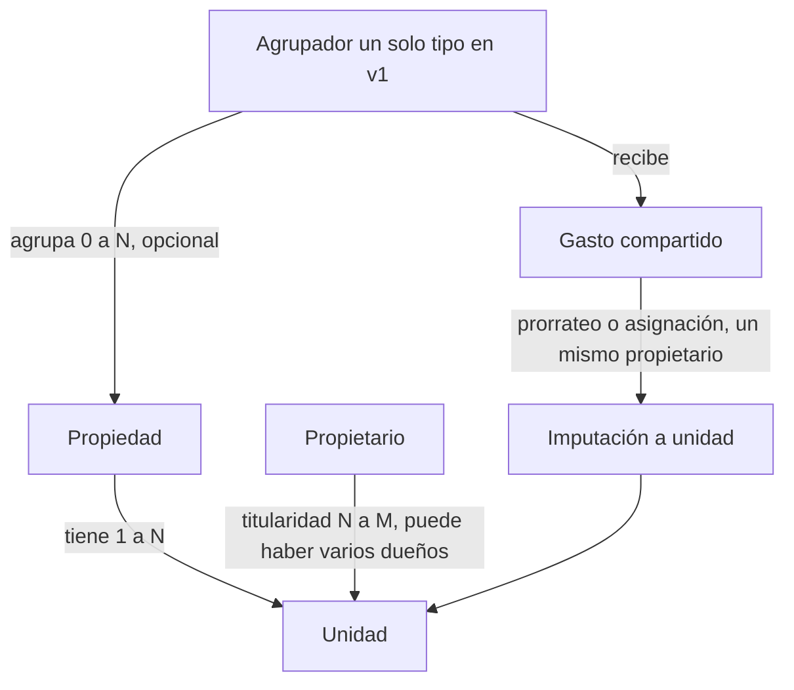
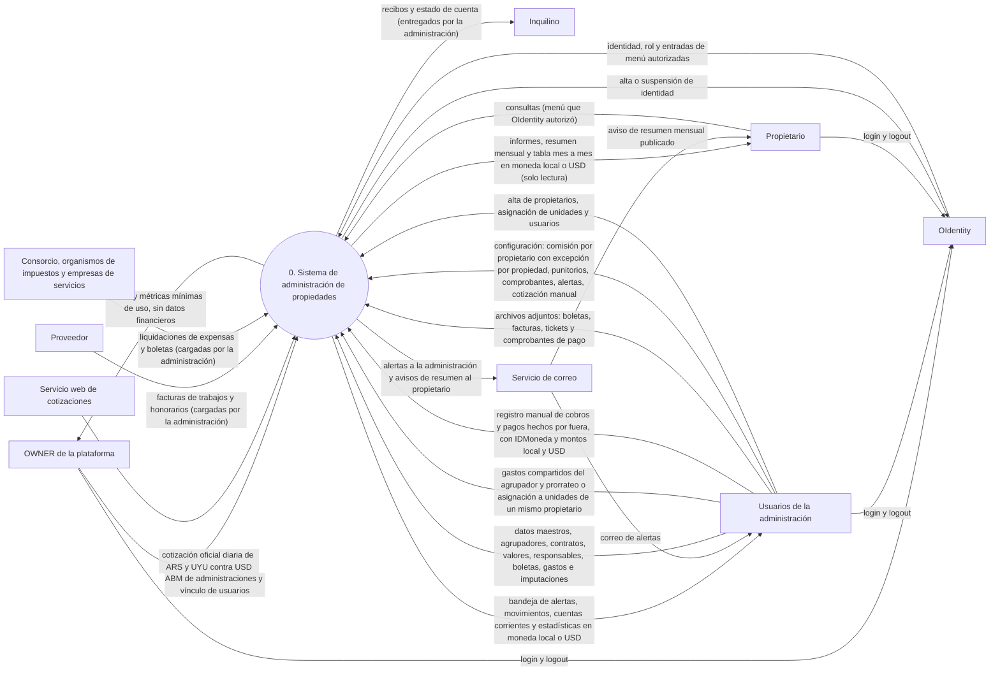

# Documento de alcance — Sistema web de administración de propiedades

> Versión 0.8 (borrador para validar con el usuario) · Fecha: 09/11/2026
> Cambios en 0.2: el administrador maneja los fondos del propietario (cobra y paga en su nombre), el responsable de cada impuesto se configura por contrato y por concepto, y se suma el portal del propietario de solo lectura en la v1.
> Cambios en 0.3: tres niveles de usuario (OWNER, administración, propietario) sin autoregistro; la Administración (tenant) se separa del Usuario y puede tener varios usuarios con el mismo permiso; resumen mensual del propietario con resultado que puede ser negativo; comisión configurable; historial de valores del alquiler; imputación de gastos generales a propietarios; alertas por correo con tabla de anticipaciones; punitorios y obligatoriedad de comprobantes configurables; estadísticas definidas; modelo preparado para alquileres temporarios; sin migración de datos ni acceso de inquilinos.
> Cambios en 0.4: cotización oficial obtenida automáticamente, con carga manual de respaldo; la comisión se configura solo por propietario y el porcentaje se calcula solo sobre el valor del alquiler; el OWNER no ve datos operativos ni financieros de las administraciones, solo métricas mínimas de uso; el modelo de cobro de la plataforma queda pendiente y fuera de alcance; el resultado negativo del propietario pasa al mes siguiente sin interés ni depósito.
> Cambios en 0.5: la fuente de cotizaciones es un web service que se elige en la implementación (decisión diferida).
> Cambios en 0.6: **se redefine el manejo de moneda** y se reemplaza lo que decían la 0.4 y la 0.5 sobre conversión a USD. Todas las transacciones se registran en la **moneda local** del país de la administración (ARS o UYU); lo que la administración cobra y paga en nombre del propietario se lleva en moneda local, y los informes y resúmenes del propietario se muestran convertidos a USD; los contratos pueden pactarse en USD y se convierten a moneda local al cobrar. **El sistema no maneja transferencias ni pagos al propietario**: la cuenta corriente de lo que la administración le pagó o le debe (rendición o giro de fondos) pasa a fase posterior, y la "liquidación" pasa a ser un **resumen mensual**. Se explicita el **principio de sistema de registro y control**: no hay conexión con nada financiero ni bancario y el sistema no ejecuta transferencias, cobros ni pagos. Todo gasto y todo pago admiten **adjuntos** de dos tipos, documento del gasto y comprobante de pago (M14, D11), y un pago con comprobante sirve como evidencia de pagado. Se cerraron las preguntas de moneda de transferencia y diferencia de cambio, y se revisó la consistencia de todo el documento.
> Cambios en 0.7: se incorpora el **Agrupador (Edificio o Terreno)** en el MVP. Al dar de alta una propiedad se puede indicar que forma parte de un agrupador; un propietario puede tener varias unidades en el mismo predio; los **gastos compartidos** se imputan al agrupador y se prorratean o se asignan solo a las unidades de ese mismo propietario. La **administración de consorcios** (copropietarios distintos, expensas por coeficiente, informe mensual a todo el consorcio) queda **considerada y diferida** a una fase muy posterior (fase 4 o posterior); el modelo de Edificio/Terreno se deja listo para reutilizarlo entonces, **sin implementar el consorcio ahora**. Se reafirman las decisiones de la 0.6: sistema de registro y control (sin conexión financiera ni bancaria; únicas integraciones: web service de cotizaciones de solo lectura y envío de correos); adjuntos de documento del gasto y comprobante de pago en todo gasto y pago; transacciones en moneda local e informes del propietario en USD; sin cuenta corriente de rendición al propietario; el resultado negativo pasa al resumen siguiente sin interés ni depósito; fuente de cotización a elegir en la implementación, con fallback manual.
> Cambios en 0.8: correcciones de reglas y cierre de las preguntas abiertas de la 0.7. **RN-02**: la extraordinaria la paga el propietario por defecto, pero es configurable (puede pagarla el inquilino por acuerdo). **RN-07**: la comisión por % sobre el alquiler es el default; se configura por propietario, con **excepción por propiedad**. **RN-17**: la actualización del alquiler (índice, frecuencia, moneda) es por contrato; ejemplos cuatrimestral o semestral en moneda local, y anual en Uruguay si el alquiler es en USD. **RN-20**: el contrato guarda su moneda; cada transacción guarda `IDMoneda` (ARS o UYU), `montoUSD`, `cotizaciónTipoCambio` y `montoIDMoneda`. El resumen es **mensual y una tabla mes a mes** (N meses previos + el actual), tipo estado de resultados. El prorrateo se elige en cada gasto y se **recuerda** por administración + propiedad + tipo de gasto. Un agrupador **puede** tener unidades de más de un propietario, sin liquidar entre copropietarios. En v1 hay **un solo tipo de agrupador** (Edificio y Terreno se comportan igual). El modelo de cobro de la plataforma sigue pendiente/excluido; el OWNER no ve datos financieros. Una administración **puede operar propiedades de varios países**; la moneda local es **por propiedad y por transacción**, no un único país por tenant. Las **estadísticas no reconvierten** el mes con la cotización del último día hábil: se arman con `montoIDMoneda` / `montoUSD` ya guardados en cada transacción. **Login, logout, contraseña, recuperación, roles y autorización de entradas de menú no se implementan acá**: los resuelve **OIdentity** (componente propio de GrupoL-Informe). Este sistema consume identidad, rol y menú autorizado, y aplica aislamiento de datos.

## 1. Objetivo

Brindar a administradores de propiedades una herramienta web para controlar, por cada unidad que administran:

- los **alquileres** (contratos pactados en moneda local o en USD, valores y su historial, cuotas y cobros a inquilinos);
- las **expensas** ordinarias y los **gastos extraordinarios**, distinguiendo quién los paga (la extraordinaria, por defecto el propietario; configurable);
- los **impuestos** y **servicios** de cada unidad, con **alertas por correo** de vencimientos e impagos;
- los **servicios/trabajos** realizados (ej. plomería) con su costo y proveedor;
- los **gastos generales** de la administración (ej. honorarios de abogado), con la opción de imputarlos total o parcialmente a propietarios;
- los **agrupadores de predio** (un solo tipo en v1; el nombre puede decir si es edificio o terreno): una propiedad puede formar parte de un agrupador; un agrupador puede tener unidades de **más de un propietario**; los **gastos compartidos** se imputan al agrupador y se prorratean o se asignan a las unidades de **un mismo propietario** (sin liquidar entre copropietarios);
- lo que la administración **cobra y paga en nombre de cada propietario**, la comisión (por propietario, con excepción por propiedad) y el **resumen mensual** del propietario, más una **tabla mes a mes** tipo estado de resultados;
- **estadísticas** de ingresos, gastos, comisión y margen, por mes y acumuladas, por propiedad, por agrupador y por administración.

El sistema **no administra consorcios**. El modelo de Edificio/Terreno queda listo para reutilizarlo en una fase muy posterior; el consorcio está **considerado y diferido** (sección 3.2 y DT-31).

Una administración puede gestionar propiedades de **varios países**. El **país y la moneda local** son de la **propiedad** (y de cada transacción), no de la administración. El contrato guarda su **moneda pactada**. Cada transacción guarda `IDMoneda` (ARS o UYU en v1), `montoIDMoneda`, `cotizaciónTipoCambio` y `montoUSD` (moneda patrón), para mostrar resúmenes y estadísticas en moneda local o en USD **sin reconvertir**.

Además, cada propietario puede entrar al sistema y consultar, en modo solo lectura, qué se cobró, cuánto ganó y qué se pagó en sus propiedades.

El sistema es **multitenant**: varias administraciones lo usan en simultáneo, cada una con sus propiedades y con **aislamiento total** de datos entre ellas. La plataforma la opera un único **OWNER**, que da de alta cada administración y sus usuarios.

### 1.1 Principio: sistema de registro y control

El sistema **no está conectado con nada financiero ni bancario** y **no ejecuta ningún tipo de transferencia, cobro ni pago**. Es solo un sistema de **registro y control**: la administración cobra y paga **por fuera del sistema** (en efectivo, por su banco, etc.) y después **carga manualmente** esos cobros y pagos. Todo lo que en este documento dice "cobro", "pago" o "cuenta de fondos" se refiere a ese registro, nunca a un movimiento de dinero real. Las integraciones externas son el **web service de cotizaciones** (solo lectura), el **envío de correos** y **OIdentity** (identidad, rol y menú; sección 1.2).

### 1.2 Identidad: OIdentity (fuera de este proyecto)

**Login, logout, contraseña, recuperación, roles y autorización de menú ya están resueltos.** Los provee **OIdentity**, componente propio del proyecto **GrupoL-Informe**. Este sistema **no implementa** autenticación, catálogo de roles ni quién ve cada entrada de menú: consume la identidad autenticada, el **rol** y las **entradas de menú autorizadas** que manda OIdentity. Lo que sí aplica acá es el **aislamiento de datos** (tenant, titularidad del propietario, el OWNER sin datos financieros).

## 2. Actores y roles

| Actor | Descripción | ¿Usa el sistema en v1? |
|---|---|---|
| **OWNER** (dueño de la plataforma, rol superadmin) | Es el usuario que encarga el sistema. Da de alta, suspende y da de baja administraciones y sus usuarios desde un ABM propio; no hay autoregistro. No ve estadísticas, datos operativos ni financieros de las administraciones (son confidenciales); solo métricas mínimas de uso, como la cantidad de propiedades. | **Sí** — ABM de administraciones y usuarios, y métricas de uso. |
| **Administrador de propiedades** (usuario de una administración) | La **administración** (tenant) es la persona o estudio que administra propiedades de terceros. **Puede operar en varios países** (Argentina y Uruguay). Puede tener **varios usuarios**. El **rol y el menú** de cada uno los asigna **OIdentity**; en datos, ven las mismas propiedades del tenant. Cargan y gestionan todo; cobran y pagan en nombre de los propietarios por fuera del sistema y registran esos cobros y pagos; dan de alta a sus clientes (propietarios) y les crean usuario. | **Sí** — datos de su administración; menú según OIdentity. |
| **Propietario** | Cliente de la administración, dueño de una o más unidades (puede tener varias en el mismo predio). Soporta expensas extraordinarias (por defecto; algunas, por acuerdo, las paga el inquilino), los impuestos que el contrato le asigne, los trabajos a su cargo, los gastos generales que se le imputen y la parte de **gastos compartidos** de sus agrupadores. Recibe **informes y resúmenes en moneda local o en USD**, y una tabla mes a mes tipo estado de resultados. | **Sí** — portal de **solo lectura**: ve únicamente lo suyo (qué se cobró, cuánto ganó, qué se pagó, resúmenes). |
| **Inquilino** | Ocupa la unidad bajo contrato. Paga alquiler, expensas ordinarias, los impuestos que el contrato le asigne, (generalmente) servicios y, si se acordó, alguna **expensa extraordinaria**. | **No** — se registra como dato; sin acceso por ahora. |
| **Proveedor** | Plomero, gasista, abogado, etc. Presta servicios y cobra. | **No** — se registra como dato. |
| **Entidades externas pasivas** | Consorcio / administración del edificio (ajeno al sistema), organismos de impuestos (en Argentina ARBA, AGIP, municipios; en Uruguay intendencias y sus equivalentes), empresas de servicios. | No — origen de boletas/liquidaciones que la administración carga manualmente. Sin integración. **Administrar un consorcio** (copropietarios distintos, expensas por coeficiente, informe al consorcio) está **considerado y diferido**; no es un actor de v1. |
| **Servicio de correo** | Sistema externo de envío de e-mails. | Integración de salida: recibe las alertas y notificaciones que genera el sistema. |
| **Servicio web de cotizaciones** | Web service externo que informa la cotización oficial de la moneda local (ARS, UYU) contra el dólar. El proveedor concreto se elige en la etapa de implementación. | Integración de **solo lectura**: el sistema lo consulta automáticamente todos los días. |
| **OIdentity** | Componente propio de identidad (proyecto **GrupoL-Informe**). Resuelve login, logout, contraseña, recuperación, **roles** y **autorización de entradas de menú**. | **Ya existe.** Este sistema no lo desarrolla: consume identidad, rol y menú autorizado. |

Jerarquía de altas: el **OWNER** da de alta cada administración y sus usuarios → los **usuarios de la administración** dan de alta propiedades (con país y moneda local), propietarios, unidades y usuarios de propietarios.

## 3. Alcance

### 3.1 Incluido (v1 / MVP)

- ABM de administraciones y de sus usuarios por el OWNER (sin autoregistro); varios usuarios por administración, **vinculados a OIdentity** (rol y menú los asigna OIdentity). Una administración **puede tener propiedades en varios países**; el país y la **moneda local** (ARS o UYU) se definen **por propiedad**.
- Métricas mínimas de uso de cada administración para el OWNER (sin datos financieros).
- Gestión de propiedades y unidades, propietarios, inquilinos y proveedores.
- **Agrupador de predio**, opcional, **un solo tipo en v1** (Edificio y Terreno se comportan igual): al dar de alta una propiedad se puede indicar que forma parte de un agrupador (existente o nuevo). Un agrupador **puede tener unidades de más de un propietario** (ej. edificio de 8 deptos del que la administración solo gestiona 3 del mismo dueño). Solo se cargan las unidades administradas.
- **Gastos compartidos del agrupador**: se imputan al agrupador y se **prorratean** o se **asignan** a las unidades de **un mismo propietario** (no entre copropietarios; eso es consorcio, fase 5). El criterio se elige en cada gasto y se recuerda por administración + propiedad + tipo de gasto.
- Contratos de alquiler tradicionales **pactados en moneda local o en USD**, con **historial de valores y vigencias** y **actualización configurable por contrato** (índice, frecuencia, moneda).
- Configuración, **por contrato y por concepto**, del responsable del pago de cada impuesto, expensa ordinaria, **expensa extraordinaria** y servicio.
- **Comisión de la administración**: el default es **porcentaje sobre el valor del alquiler**, configurable **por propietario**, con **excepción por propiedad** (p. ej. un % menor si esa propiedad no da mucha rentabilidad). También admite monto fijo.
- **Punitorios por mora** opcionales, configurables por propiedad o por contrato.
- Generación de cuotas y **registro manual** de los cobros (totales o parciales) hechos a inquilinos por fuera del sistema. Cada transacción guarda `IDMoneda`, `montoIDMoneda`, `cotizaciónTipoCambio` y `montoUSD`.
- Registro de expensas (ordinarias y extraordinarias), impuestos y servicios por unidad, con vencimientos y estado de pago (pagado con o sin comprobante).
- **Adjuntos en todo gasto y pago**: el documento del gasto (ticket, factura, boleta, liquidación de expensa) y el comprobante de pago (recibo, constancia de transferencia, ticket de pago), en imagen o PDF, como respaldo documental.
- **Obligatoriedad de comprobantes** configurable por administración o por propiedad.
- Registro de servicios/trabajos realizados con proveedor, costo y responsable del pago.
- Gastos generales de la administración, con **imputación total o parcial** a uno o más propietarios.
- **Registro manual** de todo lo que la administración cobró y pagó por fuera del sistema en nombre de cada propietario (con la cuenta de fondos y el medio usados como dato de referencia), y cuenta corriente del inquilino.
- **Resumen del propietario**: cierre **mensual** y **tabla mes a mes** (N meses previos + el actual), tipo estado de resultados, en moneda local o en USD; el resultado del mes puede ser negativo.
- **Cotización oficial diaria** de la moneda local contra USD, obtenida automáticamente, con carga manual de respaldo.
- Portal del propietario de solo lectura, con informes, resumen mensual y tabla mes a mes en moneda local o en USD.
- **Alertas por correo electrónico** (y bandeja en la aplicación) con tipos y anticipaciones configurables por la administración.
- Estadísticas: ingresos, gastos totales, comisión y margen, por mes y acumulado, por propiedad, por agrupador y por administración, en moneda local o en USD, **armadas con los importes ya guardados** en cada transacción (sin reconvertir el mes).
- Multitenancy con aislamiento total de **datos** y auditoría de cambios. Login, roles y menú los resuelve **OIdentity** (no se desarrollan acá).
- **Modelo de datos preparado** para alquileres temporarios (sin funcionalidad en v1) y para **consorcios** (reutiliza el Agrupador Edificio/Terreno; sin funcionalidad de consorcio en v1).

### 3.2 Excluido (v1) / fase posterior

- **Cualquier conexión con sistemas financieros o bancarios y cualquier ejecución de dinero** (principio 1.1): el sistema no ejecuta transferencias, cobros ni pagos; no se integra con bancos, billeteras, pasarelas de pago ni medios de cobro; no hace débitos automáticos, conciliación bancaria ni importación automática de extractos. Esto no es una fase posterior: queda fuera del producto.
- El **registro** de los giros o pagos que la administración hace al propietario y la **cuenta corriente de rendiciones** (lo que le pagó y lo que le queda por pagar): **fase posterior**, como registro manual. El sistema informa al propietario lo cobrado, lo pagado y el resultado, pero no registra cuándo ni cuánto se le giró.
- **Saldo de fondos en poder de la administración** (saldo de caja o de cuentas bancarias, calculado a partir de lo registrado): requiere registrar los giros al propietario, así que también pasa a fase posterior.
- **Login, logout, contraseña, recuperación, 2FA, catálogo de roles y autorización de entradas de menú**: ya los resuelve **OIdentity** (GrupoL-Informe). Este proyecto no los implementa (DT-36, RF-03, RF-43).
- Autoregistro de administraciones.
- Alta de usuarios de la administración por la propia administración (los da de alta el OWNER).
- Acceso de inquilinos y proveedores al sistema.
- Cualquier acción de escritura del propietario en el portal (pedidos, aprobaciones, carga de datos, mensajes).
- Acceso del OWNER a estadísticas, datos operativos o financieros de las administraciones.
- **Modelo de cobro de la plataforma** a las administraciones: **pendiente y fuera de la v1** (confirmado). El OWNER no ve datos financieros.
- **Migración de datos** desde planillas u otros sistemas (no hay datos previos para migrar).
- Funcionalidad de **alquileres temporarios** (reservas, estadías, tarifas por día): fase posterior.
- Registro de transacciones, cajas o cuentas en una moneda distinta de la local (por ejemplo, una caja en dólares billete).
- Contratos pactados en monedas que no sean la local de la propiedad (ARS o UYU) o el USD.
- Integración automática con organismos de impuestos, consorcios o empresas de servicios (lectura de boletas, pago de impuestos o servicios).
- Facturación electrónica (AFIP/ARCA en Argentina, DGI en Uruguay) y liquidación de impuestos de la administración.
- Contabilidad formal (plan de cuentas, asientos, balances).
- Lectura automática de adjuntos (OCR) y validación de su autenticidad ante bancos u organismos: los adjuntos son solo respaldo documental.
- **Administración de consorcios** (copropietarios distintos, expensas por coeficiente, liquidación del edificio, informe mensual a todo el consorcio): **considerada y diferida** a una fase **muy posterior** (fase 4 o posterior, DT-31). El sistema **recibe** la expensa de la unidad (la carga la administración) y **no la calcula**. El modelo de Agrupador (Edificio/Terreno) de la v1 queda listo para reutilizarlo entonces; **no se implementa el consorcio ahora**.
- Firma digital de contratos, gestión de reclamos/tickets, aplicación móvil nativa.
- Notificaciones por WhatsApp o SMS.

## 4. Módulos y requisitos funcionales

Los números de requisito se mantienen entre versiones; los nuevos se agregan al final de la numeración y los eliminados se indican como tales.

### M1 — Plataforma, tenancy y usuarios

- **RF-01** El OWNER gestiona, desde un ABM propio, el alta, la modificación, la suspensión y la baja de **administraciones** (tenants). La administración **no** tiene un único país ni una única moneda local: puede operar propiedades de varios países. No existe autoregistro.
- **RF-02** El OWNER da de alta, suspende y da de baja **usuarios** de cada administración (uno o varios), **vinculados a una identidad de OIdentity**. El **rol y las entradas de menú** los asigna OIdentity (RF-43). En datos, todos los usuarios de una administración ven y gestionan las mismas propiedades del tenant (RF-04).
- **RF-03** *(Fuera de este proyecto.)* Login, logout, contraseña, recuperación y 2FA los resuelve **OIdentity** (GrupoL-Informe). Este sistema no implementa pantallas ni lógica de autenticación. Roles y menú: RF-43.
- **RF-04** Todo dato de negocio queda asociado a un tenant y solo es visible para usuarios de ese tenant.
- **RF-42** La administración crea un usuario **vinculado** a un registro de propietario y a una identidad de OIdentity, y puede suspenderlo o darlo de baja en este sistema. El rol de propietario y las entradas de menú del portal las autoriza OIdentity.
- **RF-43** *(Fuera de este proyecto el catálogo y el menú.)* Los **roles** y la **autorización de entradas de menú** los maneja **OIdentity**: según el rol, habilita qué ítems de menú ve el usuario. Este sistema no define un catálogo propio de roles ni de menú; muestra las entradas que OIdentity autorizó y, en datos, sigue filtrando por tenant (RF-04), por titularidad del propietario (RN-15) y sin datos financieros para el OWNER (RN-23). Los perfiles de negocio siguen siendo OWNER, usuario de administración y propietario.

### M2 — Maestros y configuración

- **RF-05** ABM de propiedades (dirección, tipo, **país** y **moneda local** ARS o UYU). El país y la moneda local son de la propiedad, no de la administración. Al dar de alta o editar una propiedad se puede indicar que **forma parte de un Agrupador**: se elige uno existente o se crea en el momento. Una propiedad pertenece a lo sumo a un agrupador; si no se indica, queda independiente. Las propiedades de un mismo agrupador comparten país y moneda local. En v1 el agrupador es de **un solo tipo** (RF-75).
- **RF-06** ABM de unidades dentro de una propiedad (piso/depto, superficie, partidas de impuestos, números de cliente de servicios). Un propietario puede tener varias unidades en el mismo predio (mismo agrupador), en una o más propiedades.
- **RF-07** ABM de propietarios (clientes de la administración) y asignación a unidades, con porcentaje de titularidad si hay condominio.
- **RF-08** ABM de inquilinos (y garantes como dato del contrato).
- **RF-09** ABM de proveedores con rubro, identificación fiscal (CUIT o RUT) y datos de contacto.
- **RF-75** ABM de **Agrupadores** de predio: **un solo tipo en v1** (Edificio y Terreno se comportan igual; el nombre identifica el predio), dirección, **país** y moneda local (las propiedades del predio comparten ambos), datos de contacto de la administración del edificio (si aplica, como entidad pasiva). El agrupador es opcional. **Puede tener unidades de más de un propietario**. Solo se cargan las unidades que la administración gestiona (ej. un edificio de 8 deptos del que solo se administran 3). La titularidad sigue en la unidad (RF-07).
- **RF-55** Configuración de la **comisión** de la administración **por propietario** (acuerdo entre cada propietario y la administración): el **default** es **porcentaje sobre el valor del alquiler**; también admite monto fijo por mes. Valor, moneda si es fija (local o USD) y vigencia, con historial de cambios.
- **RF-80** **Excepción de comisión por propiedad**: una propiedad puede tener un porcentaje (o monto) distinto al default del propietario, por ejemplo si no da mucha rentabilidad. Prioridad: **propiedad** > **propietario**. Si la propiedad no tiene excepción, rige la del propietario.
- **RF-56** Configuración de la **obligatoriedad de comprobantes** a nivel administración (valor general) con excepción por propiedad, por tipo de movimiento (cobro, expensa, impuesto, servicio, trabajo, gasto general, gasto compartido del agrupador) y por **tipo de adjunto** (documento del gasto o comprobante de pago).
- **RF-57** Configuración de **punitorios** por propiedad (valor por defecto) y por contrato (sobrescribe): activado o no, días de gracia, tasa o monto y forma de cálculo (diario o fijo).
- **RF-58** **Obtención automática de cotizaciones**: un proceso diario consulta el servicio web de cotizaciones (a elegir en la implementación) y guarda la cotización oficial de cada moneda local en uso (ARS, UYU) contra el USD, por fecha.
- **RF-65** **Respaldo manual de cotizaciones**: si el servicio no responde o no publica la cotización del día, la administración la carga a mano; queda marcada como manual, con usuario y fecha de carga, y se usa solo dentro de esa administración.
- **RF-66** **Moneda en contratos y transacciones**: el contrato guarda su **moneda pactada**. `IDMoneda` de cada transacción es la **moneda local de la propiedad** (ARS o UYU en v1), no de la administración. Cada transacción económica guarda `IDMoneda`, `montoIDMoneda` (moneda local), `cotizaciónTipoCambio` (oficial del día de la transacción; en fines de semana y feriados, la del último día hábil **publicado**, no la del cierre de mes) y `montoUSD` (moneda patrón). Esos cuatro valores permiten mostrar resúmenes, reportes y **estadísticas** en moneda local o en USD **sin reconvertir**. El origen de la cotización (automática o manual) también se guarda.

### M3 — Contratos y alquileres

- **RF-10** Alta de contrato: tipo (tradicional en v1; temporario a futuro), unidad, inquilino(s), propietario(s), fechas, **moneda pactada** (moneda local o USD; se guarda y no cambia durante la vigencia), valor inicial, día de vencimiento, depósito, **actualización configurable** (índice, frecuencia y moneda, RN-17), configuración de punitorios y responsables por concepto (RF-44).
- **RF-44** En cada contrato se define, **por concepto** (cada impuesto, expensa ordinaria, **expensa extraordinaria**, cada servicio), quién es el responsable del pago: inquilino o propietario. Al crear el contrato se proponen los valores por defecto de la unidad (extraordinaria: propietario) y se pueden modificar. En cada carga de extraordinaria se puede cambiar el responsable (RN-02).
- **RF-11** Generación automática de cuotas según el valor vigente en cada período, expresadas en la moneda pactada.
- **RF-12** **Historial de valores**: el administrador registra cada nuevo valor del alquiler con fecha de vigencia desde, motivo (actualización pactada, renegociación, corrección) y observación; las cuotas ya generadas no cambian salvo recálculo explícito de las no cobradas.
- **RF-59** El sistema calcula la **próxima fecha de actualización** según la frecuencia pactada en el contrato (RN-17) y genera la alerta correspondiente. No calcula el índice: avisa y el administrador carga el nuevo valor (supuesto 5).
- **RF-13** Registro manual de los cobros que la administración hizo al inquilino por fuera del sistema (total o parcial, medio por el que se cobró, fecha), con recibo imprimible/PDF. Cada cobro guarda `IDMoneda`, `montoIDMoneda`, `cotizaciónTipoCambio` y `montoUSD` (RF-66). Si la cuota está pactada en USD, el sistema propone `montoIDMoneda` con la **cotización del día del cobro** y la cuota se cancela por el equivalente en USD de lo cobrado (supuesto 15). Cada cobro se registra con la cuenta de fondos que lo recibió y se acredita al propietario, menos la comisión.
- **RF-14** Cálculo de punitorios por mora solo si el contrato (o, en su defecto, la propiedad) los tiene activados. En contratos en USD se calculan en USD y se convierten junto con la cuota al cobrar.
- **RF-15** Cuenta corriente del inquilino: cuotas, expensas ordinarias, extraordinarias a su cargo, impuestos, punitorios y otros cargos vs. pagos, con los cuatro campos de moneda. Las cuotas pendientes de contratos en USD se muestran en USD; el equivalente en moneda local de lo aún no cobrado es solo referencia (aún no hay transacción).
- **RF-16** Finalización, rescisión o renovación de contrato, con alerta de vencimiento.

### M4 — Expensas

La expensa de M4 es la que **emite un consorcio ajeno** (entidad pasiva) para una unidad: el sistema la **recibe**, no la calcula. No es administración de consorcios (DT-31). Los gastos del predio de un mismo propietario van en M15.

- **RF-17** Carga mensual de la expensa de cada unidad con importe **ordinario** y **extraordinario** por separado (en moneda local), vencimiento y la liquidación de expensa adjunta (RF-70; obligatoria según RF-56).
- **RF-18** Imputación: la parte **ordinaria** se carga al responsable definido en el contrato vigente (por defecto, el inquilino; si no hay contrato, el propietario). La parte **extraordinaria** se carga al responsable configurado (por defecto, el **propietario**); se puede asignar al inquilino por acuerdo, en el contrato o en esa carga (RN-02).
- **RF-19** Registro del pago de la expensa al consorcio (ajeno), hecho por fuera del sistema, indicando si lo hizo la administración por cuenta del propietario, o el inquilino/propietario en forma directa, con el comprobante de pago adjunto (RF-71).

### M5 — Impuestos y servicios por unidad

- **RF-20** Configuración por unidad de los impuestos (ABL, inmobiliario, tasas municipales, contribución inmobiliaria, etc.) y servicios (luz, gas, agua, internet), con periodicidad y **responsable por defecto**; el responsable efectivo lo define cada contrato (RF-44).
- **RF-21** Carga de cada obligación (período, importe en moneda local, vencimiento, boleta o factura adjunta) y el registro de su pago, hecho por fuera del sistema, con su comprobante de pago adjunto (RF-70, RF-71); el cargo se imputa al responsable vigente para ese concepto y período.
- **RF-22** Los servicios son **opcionales** por unidad: se puede no controlarlos.
- **RF-23** Tablero de control de impuestos y servicios: estado por unidad y período (sin cargar, pendiente, vencido, **pagado con comprobante**, **pagado sin comprobante**) y responsable. Un pago con comprobante de pago adjunto es la evidencia de que la obligación está pagada (RN-26); el tablero permite filtrar los pagos sin comprobante.
- **RF-24** Detección de períodos faltantes ("no se cargó la boleta de este mes") según la periodicidad configurada.

### M6 — Servicios realizados y gastos de unidad

- **RF-25** Registro de trabajos realizados en una unidad, propiedad o agrupador: descripción, fecha, proveedor, costo en moneda local, factura o ticket adjunto (RF-70). Si el trabajo es del predio (varias unidades del mismo propietario), se registra como **gasto compartido** del agrupador (RF-77) y se distribuye con RF-78.
- **RF-26** Definición de quién paga el trabajo (propietario, inquilino o administración) y su imputación al propietario o a la cuenta corriente del inquilino.
- **RF-27** Registro del pago al proveedor, hecho por fuera del sistema (por cuenta del propietario o de la administración), con su comprobante de pago adjunto (RF-71), y saldo pendiente con cada proveedor.
- **RF-28** Historial de gastos por unidad.

### M7 — Gastos generales de la administración

- **RF-29** Registro de gastos no imputados a unidad (honorarios de abogado, contador, software, etc.) con categoría, proveedor, importe en moneda local, factura o ticket adjunto (RF-70) y, si se registra el pago, su comprobante de pago (RF-71).
- **RF-30** **Imputación** de un gasto general, total o parcial, a uno o más propietarios (y opcionalmente a una propiedad), por importe o por porcentaje. La suma imputada no puede superar el total; el remanente queda como gasto de la administración.
- **RF-60** Cada imputación genera un débito al propietario y aparece en su resumen mensual y en su portal con el detalle del gasto.

### M15 — Agrupadores y gastos compartidos

El agrupador es un **predio** que une propiedades y unidades de una misma administración. En v1 hay **un solo tipo** (Edificio y Terreno se comportan igual). Sirve para registrar **gastos compartidos** una sola vez y distribuirlos entre las unidades de **un** propietario. **Puede** incluir unidades de más de un propietario. No es un consorcio.

- **RF-76** Un agrupador agrupa propiedades (y, a través de ellas, unidades). Se puede crear desde su ABM (RF-75) o al dar de alta la propiedad (RF-05). **Puede tener unidades de más de un propietario.** Ejemplo: edificio de 8 departamentos del que la administración solo gestiona 3 del mismo dueño; se cargan esas 3 (u otras de otros dueños si también las administra). No se liquidan expensas entre copropietarios (fase 5).
- **RF-77** **Gasto compartido del agrupador**: se registra imputado al agrupador (no a una unidad suelta), con categoría o tipo (trabajo, impuesto o servicio del predio, otro gasto común), proveedor si aplica, vencimiento, los cuatro campos de moneda (RF-66), **documento del gasto** adjunto (RF-70) y, al registrar el pago hecho por fuera, **comprobante de pago** (RF-71). Un mismo gasto puede tener boleta y comprobante de pago.
- **RF-78** **Distribución a unidades del mismo propietario**: al confirmar el gasto, la administración elige un propietario y **prorratea** o **asigna** el importe a las unidades de **ese mismo propietario** dentro del agrupador. Modos:
  1. **asignación manual** (importe por unidad);
  2. **prorrateo en partes iguales** entre esas unidades;
  3. **prorrateo por superficie** (si las unidades tienen superficie cargada).
  El criterio se **elige en cada gasto**. Se **recuerda** por administración + propiedad (o agrupador, si el gasto es del predio) + tipo de gasto, y se sugiere la próxima vez (RF-81). La suma distribuida no supera el total. Cada parte genera un débito a ese propietario y alimenta las estadísticas de cada unidad. **No se distribuye entre propietarios distintos.**
- **RF-81** **Preferencia de prorrateo**: cada vez que se confirma un criterio (RF-78), el sistema lo guarda para esa administración, esa propiedad o agrupador y ese tipo de gasto, y lo ofrece como sugerencia en el siguiente gasto igual. Se puede cambiar; el nuevo valor pasa a ser el recordado.
- **RF-79** **Preparación para consorcios, sin implementarlos**: el Agrupador no tiene un propietario como clave; la titularidad vive en la unidad. En v1 ya puede haber unidades de distintos dueños en el mismo predio, **sin** coeficiente, **sin** liquidación del edificio y **sin** informe a todos los copropietarios. Esas funciones quedan para la fase 5.

### M8 — Movimientos y resumen mensual del propietario

- **RF-45** **Registro manual de movimientos por cuenta del propietario**: cada cobro y cada pago que la administración hizo por fuera del sistema en nombre de un propietario se carga con fecha, medio (efectivo, transferencia), cuenta de fondos usada (dato de referencia), propietario por cuenta de quien se hizo, y los cuatro campos de moneda (RF-66). No se registran giros ni transferencias al propietario.
- **RF-46** **Resultado por propietario**: cobrado − comisión − pagado por su cuenta, por mes y acumulado del año, mostrable en moneda local (`montoIDMoneda`) o en USD (`montoUSD`).
- **RF-31** Detalle de movimientos del propietario: alquileres cobrados, comisión, expensas extraordinarias, impuestos, trabajos, gastos generales imputados, **gastos compartidos del agrupador** (con el detalle por unidad) y demás pagos realizados en su nombre; cada línea con los cuatro campos de moneda.
- **RF-61** Cálculo de la comisión: se usa la excepción de la **propiedad** si existe (RF-80); si no, la del **propietario** (RF-55). El default es porcentaje **solo sobre el valor del alquiler cobrado** (no sobre punitorios, expensas, impuestos ni otros cargos). Si es monto fijo, una vez por mes.
- **RF-32** **Resumen del propietario** (antes llamado "liquidación"):
  1. **cierre mensual**: detalle de movimientos, ingresos, gastos, comisión, resultado del mes, resultado negativo arrastrado del mes anterior (si lo hay) y resultado final, en moneda local o en USD (con los `montoUSD` / `montoIDMoneda` guardados);
  2. **tabla mes a mes** tipo estado de resultados: N meses previos + el mes actual (N configurable por la administración; propuesta por defecto: 12), con las mismas columnas, para ver la evolución sin ser una cuenta corriente de rendición.
- **RF-82** El portal y los PDF del propietario muestran el cierre del mes y la tabla mes a mes (RF-32). N no cambia los meses ya cerrados.
- **RF-47** Emisión del resumen mensual y de la tabla mes a mes en PDF, publicación en el portal del propietario y aviso por correo al propietario.
- **RF-48** Un resumen cerrado no se modifica; las correcciones se hacen con ajustes en el resumen siguiente.
- **RF-69** *(Eliminado en v0.6: la rendición o giro de fondos al propietario pasó a fase posterior.)*

### M9 — Alertas y notificaciones

- **RF-33** Generación diaria de alertas según la tabla de la sección 5.1, con anticipación y repetición configurables por la administración para cada tipo.
- **RF-34** Cada alerta se envía **siempre por correo** a los usuarios de la administración y queda en la bandeja de la aplicación (abierta, vista, resuelta) hasta que se resuelve la causa.
- **RF-35** La administración puede desactivar tipos de alerta no obligatorios y elegir entre recibirlas individualmente o en un resumen diario.
- **RF-62** Notificación por correo al propietario cuando se publica su resumen mensual.

### M10 — Estadísticas y reportes

- **RF-36** Por propiedad, por agrupador y por mes: **ingresos** (alquileres y otros cobros), **gastos totales** a cargo del propietario (incluye la parte de gastos compartidos imputada a cada unidad), **comisión** de la administración y **margen** del propietario (ingresos − gastos − comisión), con el **acumulado** del año y de un rango elegido.
- **RF-37** Por administración y por mes: total de ingresos administrados, gastos totales, **comisión total**, gastos generales no imputados y **margen de la administración** (comisión − gastos generales no imputados), con acumulado. Si hay propiedades en más de una moneda local, el total comparable de la administración es en **USD** (suma de `montoUSD`); los totales en moneda local se muestran **por `IDMoneda`**, sin sumar ARS con UYU.
- **RF-38** Las estadísticas y reportes se arman **solo con los importes ya guardados** en cada transacción: moneda local (`IDMoneda`, `montoIDMoneda`) y moneda patrón USD (`montoUSD`, `cotizaciónTipoCambio`). **No se reconvierte** el mes (ni el acumulado) con la cotización del último día hábil ni con la del día de la consulta.
- **RF-63** Indicadores complementarios: morosidad, ocupación/vacancia, rentabilidad por propiedad.
- **RF-39** Exportación de reportes a CSV/Excel y PDF.
- **RF-64** El propietario ve en su portal las mismas métricas restringidas a sus propiedades, en moneda local o en USD.

### M11 — Auditoría

- **RF-40** Registro de quién creó, modificó o anuló cada movimiento, con fecha y valores anterior/nuevo.
- **RF-41** Los movimientos económicos no se borran: se anulan con motivo.
- **RF-49** Registro de accesos al portal del propietario, de las cargas manuales de cotización y de las acciones del OWNER sobre administraciones y usuarios.

### M14 — Documentos adjuntos (tickets, facturas y comprobantes de pago)

Los adjuntos son **solo respaldo documental** (principio 1.1): no son un medio de pago, no se validan contra bancos ni organismos y no disparan ninguna operación.

- **RF-70** **Documento del gasto**: todo gasto permite adjuntar el ticket, la factura, la boleta o la liquidación que lo origina (imagen o PDF). Incluye expensas (RF-17), impuestos y servicios (RF-21), servicios realizados y gastos de unidad, como plomería o electricidad (RF-25), gastos generales de la administración (RF-29) y **gastos compartidos del agrupador** (RF-77). Se adjunta a la Obligación, Expensa, Trabajo, Gasto general o Gasto compartido.
- **RF-71** **Comprobante de pago**: el registro del pago de expensas, impuestos, servicios, trabajos, gastos generales y gastos compartidos (RF-19, RF-21, RF-27, RF-77) permite adjuntar el recibo, la constancia de transferencia o el ticket de pago. Se adjunta al Pago. Los cobros a inquilinos (RF-13) también admiten un comprobante.
- **RF-72** Un mismo gasto u obligación puede tener **las dos cosas**: su documento del gasto (boleta, factura, ticket) y el comprobante de cada pago (si se pagó en partes, uno por pago). Cada registro admite varios archivos, y al subir cada uno se elige el **tipo de adjunto**.
- **RF-73** Los adjuntos se pueden agregar al crear el registro o después. La **obligatoriedad** se configura por tipo de movimiento y tipo de adjunto, a nivel administración con excepción por propiedad (RF-56, DT-11). Si un adjunto es obligatorio, el registro no se confirma sin él (RN-19). Si es opcional, el registro queda marcado como "sin comprobante" y puede generar una alerta.
- **RF-74** Vista previa y descarga de los adjuntos desde cada registro, desde el tablero de control (RF-23) y, para el propietario, desde su portal (RF-53). Un adjunto no se borra: se anula con motivo y queda en la auditoría (RF-40, RF-41).

### M12 — Portal del propietario (solo lectura)

- **RF-50** El propietario accede con la sesión de **OIdentity** y ve únicamente las unidades en las que tiene titularidad, de la administración que lo dio de alta.
- **RF-51** Resumen general, mostrable **en moneda local o en USD** (con los importes guardados en la transacción): qué se cobró, cuánto ganó (resultado del mes y acumulado), qué se pagó, próximos vencimientos e impagos a su cargo, y **tabla mes a mes** tipo estado de resultados (RF-32, RF-82).
- **RF-52** Consulta y descarga de los resúmenes mensuales cerrados (PDF), de la tabla mes a mes y de sus movimientos por período.
- **RF-53** Consulta del estado de impuestos, expensas, trabajos, gastos generales imputados y **gastos compartidos** de sus unidades (con el detalle de la parte asignada), con sus adjuntos (documento del gasto y comprobante de pago).
- **RF-54** El portal no permite crear, modificar ni anular ningún dato; no muestra gastos generales no imputados ni datos de otros propietarios.

### M13 — Panel del OWNER

- **RF-67** El OWNER ve, por administración, solo **métricas mínimas de uso**: estado, países en los que tiene propiedades, cantidad de usuarios, cantidad de propiedades, unidades y propietarios con usuario, y fecha del último acceso.
- **RF-68** El panel del OWNER no muestra importes, contratos, cobros, resultados, estadísticas ni datos personales de propietarios o inquilinos.

## 5. Reglas de negocio clave

| # | Regla |
|---|---|
| RN-01 | **Expensas ordinarias**: las paga el responsable definido en el contrato (por defecto, el **inquilino**); si la unidad está vacante, el **propietario**. |
| RN-02 | **Expensas extraordinarias**: por defecto las paga el **propietario**, pero es **configurable**. Hay extraordinarias que, por acuerdo, las paga el **inquilino** (ej. arreglo de algo del edificio que usa el inquilino). El default se define en el contrato (RF-44) y se puede cambiar en cada carga (RF-18). |
| RN-03 | **Impuestos** (ABL, inmobiliario, tasas, contribución inmobiliaria): el responsable se configura **por contrato y por concepto**. La unidad tiene un responsable por defecto que se copia al contrato y se puede cambiar. Sin contrato vigente, paga el propietario. |
| RN-04 | **Servicios** (luz, gas, agua): misma regla que impuestos (por contrato y concepto; por defecto, inquilino); el control en el sistema es opcional. |
| RN-05 | **Trabajos/reparaciones**: el responsable se elige por cada registro (por defecto, propietario si es estructural; inquilino si es por uso/daño). |
| RN-06 | **Gastos generales**: son de la administración salvo que se imputen, total o parcialmente, a uno o más propietarios. La suma imputada no supera el total del gasto. |
| RN-07 | **Comisión**: el default es **porcentaje sobre el valor del alquiler cobrado**. Se configura **por propietario** y aplica a todas sus unidades, con **excepción por propiedad** (p. ej. un % menor si esa propiedad no da mucha rentabilidad). Prioridad: **propiedad** > **propietario**. Si es monto fijo, se cobra una vez por mes. Se descuenta en el resumen. |
| RN-08 | Un pago puede ser parcial; el saldo queda pendiente y sigue generando alertas. |
| RN-09 | Una obligación se considera **impaga** cuando superó su vencimiento sin pago registrado; **faltante** cuando no se cargó el período esperado. |
| RN-10 | Ningún dato de un tenant puede ser leído, modificado ni agregado en estadísticas de otro tenant. |
| RN-11 | El ingreso del propietario se reconoce por lo **cobrado** (criterio caja); lo devengado se muestra como deuda. |
| RN-12 | La administración **cobra y paga en nombre del propietario** por fuera del sistema y lo registra: todo cobro registrado a un inquilino se acredita al propietario de la unidad (en proporción a su titularidad) y todo pago hecho por su cuenta se le debita. Cada movimiento guarda los cuatro campos de moneda (RN-20). |
| RN-13 | **Imputación por propietario y resultado negativo**: cada cobro y cada pago se imputa a un propietario concreto; lo de un propietario nunca se usa para cubrir obligaciones de otro. Si en un mes lo pagado por cuenta de un propietario más la comisión supera lo cobrado, el **resultado del mes es negativo**: se muestra como importe a compensar, pasa al resumen del mes siguiente **sin interés y sin pedir depósito**, y se compensa con los próximos cobros. |
| RN-14 | Una obligación a cargo del inquilino que pague la administración por cuenta del propietario genera un débito al inquilino y un crédito al propietario cuando el inquilino la reintegra. |
| RN-15 | El **propietario** solo lee: ve sus unidades, sus movimientos, sus métricas, su resumen mensual y la tabla mes a mes; nunca datos de otros propietarios ni del resto del tenant. |
| RN-16 | Solo el **OWNER** da de alta administraciones y sus usuarios (sin autoregistro). Una administración puede tener varios usuarios, cada uno con identidad, rol y menú de **OIdentity**. En datos, todos ven las mismas propiedades del tenant. Solo los usuarios de la administración dan de alta propietarios y les crean usuario (también vinculado a OIdentity). |
| RN-17 | **Actualización y valor del alquiler**: dependen del **contrato**. Se configura **índice**, **frecuencia** y **moneda**. Ejemplos: en Argentina y Uruguay, cuatrimestral o semestral en moneda local; en Uruguay, si el alquiler es en USD, también puede ser **anual**. En cada fecha rige un único valor vigente; los valores no se sobrescriben, se agrega uno nuevo con su vigencia. La moneda pactada del contrato no cambia durante su vigencia. El sistema no calcula el índice: avisa según la frecuencia y el administrador carga el nuevo valor. |
| RN-18 | **Punitorios**: solo se calculan si están activados. Prioridad: **contrato** > **propiedad**. |
| RN-19 | **Comprobantes**: si para un tipo de movimiento un tipo de adjunto es obligatorio, el registro no se puede confirmar sin ese adjunto. Por ejemplo, la boleta en la obligación o el comprobante en el pago. Prioridad: **propiedad** > **administración**. |
| RN-20 | **Moneda**: el país y la moneda local son de la **propiedad** (y de cada transacción), no de la administración. El contrato guarda su moneda pactada. Cada transacción guarda `IDMoneda` (por ahora **ARS** y **UYU**), `montoIDMoneda`, `cotizaciónTipoCambio` y `montoUSD`. Resúmenes, reportes y **estadísticas** se arman con esos valores guardados: **no se reconvierte** el mes con la cotización del último día hábil ni con la del día de la consulta. |
| RN-21 | **Resumen**: se emite un cierre por propietario y por mes calendario, más una **tabla mes a mes** (N meses previos + el actual) tipo estado de resultados. Un mes cerrado no admite movimientos nuevos (van al mes siguiente como ajuste). |
| RN-22 | **Cobro de contratos en USD**: el cobro se registra en moneda local; el importe sale de multiplicar lo adeudado en USD por la cotización oficial del día del cobro. La cuota se cancela por el equivalente en USD de lo cobrado; si es parcial, queda el resto pendiente en USD. |
| RN-23 | **Confidencialidad frente al OWNER**: el OWNER no accede a datos operativos, financieros ni personales de ninguna administración; solo a métricas de uso agregadas (RF-67). |
| RN-24 | **Sin pagos al propietario**: el sistema no registra transferencias, giros ni pagos de la administración al propietario, ni lo que le queda por pagar. El resumen informa lo cobrado, lo pagado por su cuenta, la comisión y el resultado. |
| RN-25 | **Solo registro**: ningún registro de cobro, pago o cuenta de fondos mueve dinero ni dispara una operación externa. El sistema no valida los registros contra bancos ni medios de pago; su respaldo es el comprobante adjunto (RN-19). |
| RN-26 | **Evidencia de pago**: una obligación (impuesto, servicio, expensa o gasto compartido del agrupador) figura como **pagada con comprobante** cuando su pago registrado tiene un comprobante de pago adjunto. Sin ese adjunto figura como **pagada sin comprobante**. Es evidencia documental cargada por la administración, no una verificación contra el organismo ni el banco. |
| RN-27 | **Gastos compartidos del agrupador**: se imputan al Agrupador y se prorratean o se asignan **solo** a unidades de **un mismo propietario** en ese predio. El criterio se elige en cada gasto y se recuerda por administración + propiedad + tipo de gasto. Un agrupador **puede** tener unidades de más de un propietario; no se prorratea entre dueños distintos ni se liquida el edificio. |
| RN-28 | **Agrupador no es consorcio.** En v1 hay **un solo tipo** de agrupador (Edificio y Terreno se comportan igual) y puede incluir unidades de distintos dueños. El consorcio (coeficiente, liquidación del edificio, informe a todos los copropietarios) está **considerado y diferido** a la fase 5. |

### 5.1 Tipos de alerta y anticipación sugerida

Todas se envían por correo a los usuarios de la administración y quedan en la bandeja de la aplicación, compartida por esos usuarios. Las anticipaciones y repeticiones son valores por defecto que la administración puede cambiar por tipo.

| Tipo de alerta | Disparador | Anticipación / momento sugerido | Repetición sugerida |
|---|---|---|---|
| Impuesto por vencer | Vencimiento de una obligación de impuesto sin pago | 7 días antes | Recordatorio 1 día antes |
| Impuesto impago | Vencimiento superado sin pago | Día siguiente al vencimiento | Cada 7 días hasta el pago |
| Boleta faltante | No se cargó el período esperado de un impuesto, expensa o servicio controlado | 5 días después de la fecha esperada de emisión | Cada 7 días |
| Expensa por vencer | Vencimiento de la expensa sin pago | 5 días antes | Recordatorio 1 día antes |
| Expensa impaga | Vencimiento superado sin pago | Día siguiente al vencimiento | Cada 7 días |
| Servicio por vencer (si se controla) | Vencimiento de un servicio sin pago | 3 días antes | — |
| Servicio impago (si se controla) | Vencimiento superado sin pago | Día siguiente al vencimiento | Cada 7 días |
| Alquiler impago | Cuota vencida sin cobro total (tras los días de gracia, si hay) | Día siguiente al vencimiento o al fin de la gracia | Cada 5 días hasta el cobro |
| Actualización de alquiler | Próxima fecha de actualización pactada | 15 días antes | Recordatorio el día de la actualización si no se cargó el nuevo valor |
| Vencimiento / renovación de contrato | Fecha de fin del contrato | 90, 60 y 30 días antes | — |
| Pago a proveedor pendiente | Trabajo con saldo impago al proveedor | 7 días después de la factura | Cada 7 días |
| Resultado negativo de propietario (informativa) | El resultado del mes de un propietario queda negativo | Inmediata | Semanal mientras persista |
| Resumen mensual pendiente de cierre | Mes terminado sin resumen cerrado | 3 días después del fin del mes | Cada 3 días |
| Pago sin comprobante (informativa, desactivable) | Pago registrado de impuesto, servicio o expensa sin comprobante de pago adjunto | 3 días después del registro del pago | Semanal mientras persista |
| Cotización faltante | No hay cotización del día (falló el servicio y no se cargó a mano) | El mismo día del fallo | Diaria hasta que se obtenga o se cargue a mano |

Las obligaciones y gastos registrados en un agrupador disparan los **mismos tipos de alerta** que los de unidad (impuesto, servicio, boleta faltante, pago a proveedor, pago sin comprobante), según la naturaleza del gasto compartido.

## 6. Requisitos no funcionales

- **RNF-01 Multitenancy**: identificador de tenant en todas las entidades de negocio; aislamiento forzado en la capa de datos (p. ej. filtros obligatorios o row-level security), no solo en la interfaz. Pruebas automáticas de aislamiento.
- **RNF-02 Seguridad**: HTTPS y protección OWASP Top 10 en este sistema. Contraseñas, sesiones, login/logout, 2FA, **roles y autorización de menú** los resuelve **OIdentity**; acá no se guardan contraseñas ni se implementa el flujo de ingreso ni un catálogo de permisos de pantalla.
- **RNF-03 Autorización**: las **entradas de menú** las autoriza **OIdentity** según el rol. Este sistema no decide el menú; sí aísla **datos** por tenant, filtra al propietario por titularidad (no solo ocultando pantallas) y deja al OWNER sin datos de negocio de las administraciones (solo métricas de uso, RF-67).
- **RNF-04 Auditoría**: bitácora inmutable de cambios sobre datos económicos y de seguridad (accesos con identidad de OIdentity, altas de administraciones, usuarios y propietarios, cargas manuales de cotización, accesos al portal; cada acción queda asociada al usuario concreto que la hizo, no solo a la administración), retenida al menos 5 años.
- **RNF-05 Datos personales**: cumplimiento de la normativa de protección de datos del **país de cada propiedad** (Ley 25.326 en Argentina, Ley 18.331 en Uruguay); datos de inquilinos y propietarios accesibles solo para su tenant y, en el caso del propietario, solo los propios.
- **RNF-06 Archivos**: adjuntos en imagen o PDF, con los formatos y el límite de tamaño del supuesto 19, guardados en almacenamiento privado, con acceso por URL firmada y aislados por tenant y por propietario.
- **RNF-07 Integridad**: los resultados de propietarios, las cuentas corrientes de inquilinos y los resúmenes se calculan a partir de movimientos inmutables; cada cobro o pago queda imputado a un único propietario (o a la administración). Un gasto compartido se distribuye solo entre unidades de ese mismo propietario. Cada transacción conserva `IDMoneda`, `montoIDMoneda`, `cotizaciónTipoCambio` y `montoUSD`.
- **RNF-08 Correo**: envío por un proveedor transaccional con dominio autenticado (SPF/DKIM), reintentos ante fallas y registro de cada envío (destinatario, tipo, estado).
- **RNF-09 Disponibilidad y respaldo**: backups diarios con restauración probada; disponibilidad objetivo 99,5 %. Los procesos de alertas y de cotizaciones corren al menos una vez por día.
- **RNF-10 Usabilidad**: web responsive (usable desde el celular, especialmente el portal del propietario), en español, formato de fecha dd/mm/aaaa y formato de moneda según el **país de la propiedad** (ARS o UYU), con USD donde corresponda.
- **RNF-11 Rendimiento**: pantallas y reportes habituales en menos de 2 s para un tenant de hasta 500 unidades.
- **RNF-12 Precisión monetaria**: importes con decimales exactos (sin punto flotante); `IDMoneda` con código ISO 4217 (ARS, UYU en v1; USD en el contrato y en `montoUSD`); cotizaciones con al menos 6 decimales.
- **RNF-14 Sin integraciones financieras**: el sistema no tiene conexiones con bancos, billeteras, pasarelas de pago, medios de cobro ni organismos, y no guarda credenciales bancarias ni datos de tarjetas. Las integraciones externas son el web service de cotizaciones (**solo lectura**, RNF-13), el proveedor de correo (**solo envío**, RNF-08) y **OIdentity** (identidad, rol y menú; no se reimplementa). Cualquier integración nueva requiere una decisión explícita que revise el principio 1.1.
- **RNF-13 Integración de cotizaciones**: el sistema solo lee datos del servicio, nunca le envía información de las administraciones; consulta diaria al servicio web de cotizaciones con reintentos, detrás de una interfaz que permita cambiar de proveedor sin tocar el resto del sistema. Si falla, se usa el último día hábil publicado cuando corresponde; si no hay dato, se genera la alerta "Cotización faltante" y se habilita la carga manual. Sin cotización del día no se pueden confirmar transacciones que requieran `cotizaciónTipoCambio` ni `montoUSD` nuevos.

## 7. Entidades principales del modelo de datos

Todas las entidades de negocio llevan `tenant_id`. El **país y la moneda local** viven en la **propiedad** (no en la administración). El **contrato** guarda su moneda pactada. **Toda transacción económica** guarda: `IDMoneda` (el de la propiedad: ARS o UYU en v1), `montoIDMoneda`, `cotizaciónTipoCambio` y `montoUSD` (moneda patrón). Las estadísticas usan esos importes; no reconvierten.

| Entidad | Descripción / atributos clave |
|---|---|
| Administración (tenant) | Entidad separada del usuario: razón social, identificación fiscal (CUIT o RUT), estado, configuración general (obligatoriedad de comprobantes, alertas). **No** tiene un único país ni una única moneda. Tiene uno o más usuarios. Puede administrar propiedades de varios países. |
| Usuario | Identidad de **OIdentity**, e-mail, nombre, estado, administración a la que pertenece (vacía para OWNER); si es propietario, vínculo al registro de Propietario. Relación N:1 con Administración. **Rol y menú autorizado vienen de OIdentity**; este sistema no guarda contraseñas ni un catálogo de permisos de pantalla. |
| Agrupador | Predio opcional. **Un solo tipo en v1** (Edificio y Terreno se comportan igual); nombre o identificación, dirección, **país** y moneda local (las propiedades del agrupador comparten país y moneda). Relación 1:N con Propiedad. No tiene un propietario como clave. **Puede tener unidades de más de un propietario**; solo se cargan las unidades administradas. Preparado para consorcio futuro (RF-79). |
| Propiedad | Dirección, tipo, **país**, **moneda local** (ARS o UYU; es el `IDMoneda` por defecto de sus transacciones); **agrupador opcional** (a lo sumo uno); punitorios, obligatoriedad de comprobantes y **excepción de comisión** propios (opcionales, sobrescriben). Si es independiente, puede guardar datos de contacto de la administración del edificio ajeno (para recibir expensas de M4). |
| Unidad | Propiedad, identificación, partidas de impuestos, nros. de cliente de servicios, superficie (para prorrateo, RF-78); apta para alquiler tradicional y/o temporario. Un propietario puede tener varias unidades en el mismo agrupador. |
| Propietario | Cliente de la administración: datos personales y fiscales; comisión acordada (ver Configuración de comisión); relación N:M con Unidad (Titularidad, con %). |
| Inquilino | Datos personales; garantes. En temporarios, también el huésped. |
| Proveedor | Rubro, CUIT o RUT, contacto. |
| Moneda | Código ISO 4217 y símbolo: ARS, UYU (monedas locales) y USD. |
| Cotización | Moneda local, fecha, valor contra USD, origen (automática o manual), fuente; si es manual, administración y usuario que la cargó. Las automáticas son comunes a toda la plataforma (sin `tenant_id`); las manuales pertenecen a una administración. |
| Contrato | **Tipo** (tradicional / temporario), unidad, inquilino(s), fechas de inicio y fin (con precisión de día), **moneda pactada** (se guarda; local o USD), **actualización** (índice, frecuencia, moneda), punitorios propios, estado. |
| Valor de contrato | Contrato, importe en la moneda pactada, vigencia desde, vigencia hasta, motivo, observación, usuario que lo cargó. |
| Responsabilidad por concepto | Contrato + concepto de obligación (impuesto, servicio, expensa ordinaria, **expensa extraordinaria**) → responsable (inquilino o propietario), con vigencia. |
| Configuración de comisión | Propietario (default: % sobre el alquiler), tipo (porcentaje o monto fijo mensual), valor, moneda si es fija (local o USD), vigencia desde/hasta. Opcional: **excepción por propiedad** (RF-80). |
| Preferencia de prorrateo | Administración + propiedad o agrupador + tipo de gasto → último criterio usado (asignación manual, partes iguales, por superficie), para sugerirlo la próxima vez (RF-81). |
| Configuración de punitorios | Ámbito (propiedad o contrato), activo, días de gracia, tasa o monto, forma de cálculo. |
| Cuota / cargo de alquiler | Contrato, período (mensual o rango de fechas para temporarios), importe en la moneda pactada, saldo pendiente, vencimiento, estado. |
| Cobro | Registro de un cobro hecho por fuera del sistema: inquilino, fecha, medio, cuenta de fondos (referencia), `IDMoneda`, `montoIDMoneda`, `cotizaciónTipoCambio`, `montoUSD`; aplicación a uno o más cargos. |
| Expensa | Unidad, período, importe ordinario, importe extraordinario, responsable de cada parte, vencimiento, liquidación adjunta, pagos, campos de moneda (RF-66). |
| Concepto de obligación | Impuesto o servicio configurado por unidad (tipo, periodicidad, responsable por defecto, opcional). |
| Obligación (boleta) | Concepto, período, importe, vencimiento, responsable efectivo, estado (incluye pagada con o sin comprobante, RN-26), adjuntos del tipo documento del gasto, pagos. |
| Trabajo realizado | Unidad/propiedad, proveedor, descripción, costo, responsable del pago, factura o ticket adjunto, pagos. |
| Gasto general | Categoría, proveedor, importe, fecha, factura o ticket adjunto, pagos. |
| Imputación de gasto general | Gasto general, propietario, propiedad (opcional), importe o porcentaje. |
| Gasto compartido | Agrupador, tipo o categoría (trabajo, impuesto o servicio del predio, otro), proveedor (opcional), campos de moneda (RF-66), vencimiento, propietario a cuyas unidades se distribuye, criterio de prorrateo usado, documento del gasto adjunto, pagos. |
| Imputación de gasto compartido | Gasto compartido, unidad, importe o porcentaje; la unidad debe ser de ese mismo propietario y pertenecer al agrupador. |
| Pago | Registro de un pago hecho por fuera del sistema a proveedor, consorcio ajeno u organismo; vinculado a obligación, expensa, trabajo, gasto general o gasto compartido, a la cuenta de fondos usada (referencia) y al propietario por cuenta de quien se pagó; puede tener adjuntos del tipo comprobante de pago. No incluye pagos al propietario. |
| Cuenta de fondos | **Etiqueta de referencia** cargada a mano (p. ej. "Caja efectivo", "Banco X cta. 123") para indicar dónde entró o salió el dinero de un cobro o pago registrado. No tiene conexión con ningún banco, no guarda credenciales y no se controla su saldo en v1. |
| Movimiento del propietario | Débito o crédito contable imputado a un propietario (cobro, comisión, pago por su cuenta, gasto imputado, ajuste), con origen y los cuatro campos de moneda (RF-66). Es un registro, no un movimiento de dinero. |
| Movimiento de cuenta corriente del inquilino | Débito o crédito sobre un inquilino, con origen y los cuatro campos de moneda. |
| Resumen del propietario | Período, detalle de movimientos, ingresos, gastos, comisión, resultado del mes, resultado negativo arrastrado y resultado final en moneda local y en USD (con los montos guardados), **tabla mes a mes** (N previos + actual), estado (abierto/cerrado), PDF. |
| Configuración de alerta | Tenant, tipo de alerta, activa, anticipación, repetición, modo (individual o resumen diario). |
| Alerta | Tipo, entidad origen, fecha, estado (abierta, vista, resuelta). |
| Envío de correo | Alerta o notificación, destinatario, fecha, estado de entrega. |
| Configuración de comprobantes | Ámbito (administración o propiedad), tipo de movimiento, tipo de adjunto (documento del gasto o comprobante de pago), obligatorio sí/no. |
| Adjunto (comprobante) | Archivo de respaldo, **solo registro** (no es medio de pago). Datos: archivo (imagen o PDF, supuesto 19), nombre, formato, tamaño, huella del archivo, usuario y fecha de carga, estado (vigente o anulado con motivo). **Tipo de adjunto**: *documento del gasto* (boleta, factura, ticket, liquidación de expensa) o *comprobante de pago* (recibo, constancia de transferencia, ticket de pago). Se vincula a una **Obligación, Expensa, Trabajo realizado, Gasto general o Gasto compartido** (documento del gasto), o a un **Pago o Cobro** (comprobante de pago). Un mismo gasto puede tener adjuntos de los dos tipos. |
| Registro de auditoría | Usuario, acción, entidad, valores anterior/nuevo, fecha. |

**Preparación para alquileres temporarios**: el contrato tiene un campo *tipo* y fechas con precisión de día; las cuotas/cargos admiten un rango de fechas en lugar de un mes; la unidad indica si es apta para temporario. Así, en una fase posterior se agregan reservas, tarifas por noche y calendario de disponibilidad sin rehacer contratos, cobros ni resúmenes.

**Preparación para consorcios** (considerada y diferida, no se implementa ahora): el Agrupador no está atado a un propietario; la unidad ya tiene titularidad. En una fase muy posterior se pueden agregar coeficiente por unidad, liquidación de expensas del edificio e informe mensual a todos los copropietarios del agrupador, sin rehacer el predio, las unidades ni los gastos compartidos.

El agrupador **puede** tener unidades de más de un propietario. El gasto compartido se elige para **un** propietario y solo sale hacia **sus** unidades. El consorcio (coeficiente, informe a todos) no forma parte de este flujo.

## 8. Diagrama de flujo de datos (DFD)

### 8.1 Nivel 0 — Diagrama de contexto

Interactúan directamente con el sistema el OWNER, los usuarios de la administración y el **propietario** (solo lectura), **después** de autenticarse en **OIdentity**. Login, logout, roles y qué entradas de menú ve cada uno **no pasan por este sistema**: los resuelve OIdentity. Inquilinos, proveedores y entidades externas no interactúan con el sistema: sus documentos los carga la administración, y los recibos los entrega ella. El **consorcio** que aparece como entidad externa es el emisor ajeno de la liquidación de expensa de la unidad (M4), no un módulo del sistema: administrar consorcios está considerado y diferido (DT-31). **Ningún flujo representa dinero**: los cobros y pagos ocurren por fuera y entran solo como registros manuales de la administración, y el sistema no envía pagos a nadie (principio 1.1). Las integraciones son el servicio web de cotizaciones (solo lectura), el servicio de correo (solo envío) y OIdentity (identidad, rol y menú). El OWNER solo recibe métricas de uso.

### 8.2 Nivel 1

```mermaid
flowchart TB
    OWN["OWNER"]
    ADM["Administración"]
    PROP["Propietario"]
    INQ["Inquilino"]
    PROV["Proveedor"]
    EXT["Consorcio / organismos / empresas de servicios"]
    MAIL["Servicio de correo"]
    COT["Servicio web de cotizaciones"]
    OID["OIdentity"]

    P1(("1.0 Gestionar administraciones y usuarios"))
    P2(("2.0 Gestionar maestros y configuración"))
    P3(("3.0 Gestionar contratos, valores y cobros"))
    P4(("4.0 Registrar expensas"))
    P5(("5.0 Controlar impuestos y servicios"))
    P6(("6.0 Registrar trabajos, gastos generales y gastos compartidos"))
    P7(("7.0 Emitir resúmenes y tabla mes a mes"))
    P8(("8.0 Generar y enviar alertas"))
    P9(("9.0 Producir estadísticas y reportes"))
    P10(("10.0 Portal del propietario"))
    P11(("11.0 Obtener cotizaciones"))

    D1[("D1 Administraciones y usuarios")]
    D2[("D2 Propiedades, unidades, agrupadores y personas")]
    D3[("D3 Contratos, valores, cuotas y responsables")]
    D4[("D4 Movimientos de propietarios y cuentas corrientes de inquilinos")]
    D5[("D5 Obligaciones: expensas, impuestos, servicios")]
    D6[("D6 Trabajos, gastos generales, gastos compartidos e imputaciones")]
    D7[("D7 Resúmenes mensuales")]
    D8[("D8 Alertas y envíos de correo")]
    D9[("D9 Auditoría")]
    D10[("D10 Configuración y cotizaciones")]
    D11[("D11 Documentos adjuntos")]

    OWN -->|"ABM de administraciones y vínculo de usuarios"| P1
    P1 -->|"estado y métricas mínimas de uso, sin datos financieros"| OWN
    ADM -->|"usuarios de propietarios"| P1
    D2 -->|"propietario a vincular; cantidades de propiedades y unidades"| P1
    OID -->|"identidad, rol y menú autorizado"| P1
    P1 -->|"administración, usuarios, vínculo OIdentity"| D1
    P1 -->|"alta o suspensión de identidad"| OID
    D1 -->|"contexto de tenant"| P2

    ADM -->|"propiedades con país y moneda local, agrupadores, unidades, propietarios, titularidades, inquilinos, proveedores"| P2
    ADM -->|"comisión por propietario con excepción por propiedad, punitorios, comprobantes, alertas"| P2
    P2 -->|"datos maestros"| D2
    P2 -->|"configuración"| D10

    COT -->|"cotización oficial diaria contra USD"| P11
    ADM -->|"cotización manual de respaldo"| P11
    P11 -->|"cotización por moneda local y fecha, con origen"| D10

    ADM -->|"contrato, moneda pactada, nuevo valor y vigencia, responsables, registro del cobro hecho por fuera"| P3
    D2 -->|"unidad, inquilino, propietario"| P3
    D10 -->|"punitorios, comisión del propietario o excepción de la propiedad, comprobantes, cotización del día"| P3
    P3 -->|"contrato, historial de valores, cuotas en moneda pactada, actualización, responsables"| D3
    P3 -->|"cobro con IDMoneda, montos local y USD, crédito al propietario y comisión"| D4
    P3 -->|"recibo (entregado por la administración)"| INQ

    EXT -->|"liquidación de expensa (cargada por la administración)"| P4
    ADM -->|"carga de expensa y registro de su pago, con adjuntos"| P4
    D3 -->|"contrato vigente y responsables de ordinaria y extraordinaria"| P4
    D10 -->|"obligatoriedad de comprobantes"| P4
    P4 -->|"expensa ordinaria y extraordinaria"| D5
    P4 -->|"cargos al responsable y pago registrado por cuenta del propietario"| D4

    EXT -->|"boletas de impuestos y servicios (cargadas por la administración)"| P5
    ADM -->|"conceptos por unidad, boleta, registro del pago, con adjuntos"| P5
    D2 -->|"conceptos por unidad"| P5
    D3 -->|"responsable por concepto"| P5
    D10 -->|"obligatoriedad de comprobantes"| P5
    P5 -->|"obligación, responsable y estado de pago"| D5
    P5 -->|"cargo al responsable y pago registrado por cuenta del propietario"| D4

    PROV -->|"factura de trabajo u honorarios (cargada por la administración)"| P6
    ADM -->|"trabajo, gasto general, gasto compartido del agrupador, prorrateo o asignación, registro del pago, con adjuntos"| P6
    D2 -->|"unidades del agrupador y titularidad del propietario"| P6
    D10 -->|"obligatoriedad de comprobantes y preferencia de prorrateo"| P6
    P6 -->|"criterio de prorrateo usado"| D10
    P6 -->|"trabajo, gasto, gasto compartido e imputaciones a unidades"| D6
    P6 -->|"cargo al responsable o al propietario imputado, pago registrado"| D4

    ADM -->|"cierre mensual"| P7
    D4 -->|"movimientos del propietario con montos local y USD"| P7
    D10 -->|"comisión del propietario o de la propiedad, N meses de la tabla"| P7
    D7 -->|"meses previos cerrados"| P7
    P7 -->|"resumen cerrado, tabla mes a mes, resultado negativo arrastrado, PDF"| D7
    P7 -->|"aviso de resumen publicado"| MAIL

    D3 -->|"cuotas vencidas, actualizaciones y fin de contratos"| P8
    D5 -->|"vencimientos y faltantes"| P8
    D4 -->|"resultados negativos"| P8
    D6 -->|"pagos a proveedores pendientes y gastos compartidos"| P8
    D7 -->|"resúmenes sin cerrar"| P8
    D10 -->|"tipos, anticipaciones y cotizaciones faltantes"| P8
    P8 -->|"alertas y registro de envíos"| D8
    P8 -->|"correo de alerta"| MAIL
    MAIL -->|"alertas"| ADM
    MAIL -->|"aviso de resumen"| PROP
    D8 -->|"bandeja de alertas"| ADM

    D4 -->|"ingresos, gastos y comisiones con montos local y USD"| P9
    D6 -->|"gastos generales no imputados"| P9
    D2 -->|"propiedades y agrupadores"| P9
    D6 -->|"gastos compartidos imputados a unidades"| P9
    D10 -->|"comisiones y preferencias"| P9
    P9 -->|"estadísticas con montos guardados, en moneda local o USD, sin reconvertir"| ADM

    PROP -->|"consultas"| P10
    OID -->|"identidad, rol y menú del propietario"| P10
    D1 -->|"usuario y propietario vinculado"| P10
    D2 -->|"unidades con titularidad"| P10
    D4 -->|"movimientos propios"| P10
    D5 -->|"estado de obligaciones de sus unidades"| P10
    D6 -->|"gastos compartidos de sus unidades"| P10
    D7 -->|"resúmenes mensuales y tabla mes a mes propios"| P10
    D10 -->|"N meses de la tabla"| P10
    P9 -->|"métricas de sus propiedades"| P10
    P10 -->|"informes, resumen y tabla mes a mes en moneda local o USD"| PROP
    P10 -->|"registro de accesos"| D9

    P1 -->|"acciones sobre administraciones"| D9
    P11 -->|"cargas manuales de cotización"| D9
    P3 -->|"cambios"| D9
    P4 -->|"cambios"| D9
    P5 -->|"cambios"| D9
    P6 -->|"cambios"| D9
    P7 -->|"cierres de resúmenes"| D9

    P3 -->|"comprobantes de cobro"| D11
    P4 -->|"liquidación de expensa y comprobante de pago"| D11
    P5 -->|"boleta o factura y comprobante de pago"| D11
    P6 -->|"factura o ticket, gasto compartido y comprobante de pago"| D11
    D11 -->|"obligatoriedad cumplida y evidencia de pago"| P5
    D11 -->|"faltantes de adjuntos obligatorios"| P8
    D11 -->|"adjuntos propios"| P10
```

Todos los procesos de negocio (2.0 a 10.0) operan dentro del contexto del tenant, obtenido de D1; el país y la moneda local salen de la propiedad (D2) y de cada transacción (D4). Para legibilidad no se dibuja ese flujo en cada proceso. Ningún proceso ejecuta cobros ni pagos: 3.0 a 6.0 solo registran lo que la administración hizo por fuera, y 7.0 emite el resumen mensual y la tabla mes a mes. El proceso 9.0 arma estadísticas con `montoIDMoneda` y `montoUSD` ya guardados, sin reconvertir el mes. Los documentos de inquilinos, proveedores y entidades externas entran porque la administración los carga. El consorcio de EXT es emisor ajeno de liquidaciones de expensa (4.0), no un proceso del sistema. El proceso 6.0 registra gastos compartidos del agrupador, los prorratea o asigna a unidades de un mismo propietario y recuerda el criterio en D10. El proceso 1.0 no autentica: recibe de OIdentity la identidad, el rol y las entradas de menú, y guarda el vínculo tenant–usuario. El proceso 10.0 solo lee y únicamente escribe el registro de accesos en D9; el menú del portal lo autorizó OIdentity. El proceso 11.0 guarda cotizaciones automáticas comunes a la plataforma y manuales por administración; esas cotizaciones alimentan los cuatro campos de moneda de cada transacción **en el momento del registro**. El OWNER solo recibe de 1.0 conteos de uso, nunca importes ni registros individuales.

### 8.3 Tabla de procesos y almacenes

| Código | Nombre | Descripción |
|---|---|---|
| 1.0 | Gestionar administraciones y usuarios | ABM de administraciones y de sus usuarios por el OWNER, métricas mínimas de uso para el OWNER, usuarios de propietarios por la administración, **vínculo con OIdentity** (identidad, rol y menú) y contexto de tenant. No autentica. La administración no tiene un único país. |
| 2.0 | Gestionar maestros y configuración | ABM de propiedades (**país y moneda local**), **agrupadores (un solo tipo en v1)**, unidades, propietarios y titularidades, inquilinos y proveedores; comisión por propietario con excepción por propiedad, punitorios, comprobantes obligatorios y alertas. |
| 3.0 | Gestionar contratos, valores y cobros | Contratos con moneda pactada, actualización (índice, frecuencia, moneda), historial de valores, responsables por concepto (incluye extraordinaria), cuotas, punitorios opcionales, registro de cobros hechos por fuera con los cuatro campos de moneda, comisión y recibos. |
| 4.0 | Registrar expensas | Carga de la expensa **recibida** de un consorcio ajeno, separación ordinaria/extraordinaria, imputación según responsable (extraordinaria por defecto al propietario, configurable) y registro del pago. No calcula ni administra el consorcio. |
| 5.0 | Controlar impuestos y servicios | Conceptos por unidad, boletas, imputación según responsable del contrato y registro de pagos. |
| 6.0 | Registrar trabajos, gastos generales y gastos compartidos | Trabajos con proveedor, gastos generales con imputación total o parcial a propietarios, **gastos compartidos del agrupador** con prorrateo o asignación a unidades de un mismo propietario (criterio elegido y recordado), y registro de pagos. |
| 7.0 | Emitir resúmenes de propietarios | Cierre mensual (cobros − comisión − pagos por su cuenta, más el resultado negativo arrastrado) y **tabla mes a mes** tipo estado de resultados (N previos + actual), en moneda local o USD con los montos guardados, PDF y aviso por correo. No registra pagos al propietario. |
| 8.0 | Generar y enviar alertas | Proceso diario que detecta las situaciones de la tabla 5.1 y envía los correos. |
| 9.0 | Producir estadísticas y reportes | Ingresos, gastos, comisión y margen por mes y acumulado, por propiedad, **por agrupador** y por administración, en moneda local o USD, **con los importes ya guardados** (sin reconvertir el mes). Si hay varias monedas locales, el total de la administración comparable es en USD. |
| 10.0 | Portal del propietario | Consulta de solo lectura, en moneda local o USD, de lo cobrado, ganado y pagado, resumen mensual, tabla mes a mes, movimientos y comprobantes propios. |
| 11.0 | Obtener cotizaciones | Proceso diario de solo lectura que trae la cotización oficial de cada moneda local contra USD; carga manual de respaldo por la administración. |
| D1 | Administraciones y usuarios | Administraciones (tenants), sus usuarios y vínculo usuario–propietario e identidad OIdentity. El rol y el menú no se catalogan acá: llegan de OIdentity. Sin país ni moneda únicos. |
| D2 | Propiedades, unidades, agrupadores y personas | Maestros de negocio (propiedad con país y moneda local), agrupadores (un solo tipo en v1) y titularidades. Un agrupador puede tener unidades de más de un propietario. |
| D3 | Contratos, valores, cuotas y responsables | Contratos con moneda e índice/frecuencia de actualización, historial de valores y cuotas, y responsable por concepto (incluye extraordinaria). |
| D4 | Movimientos de propietarios y cuentas corrientes de inquilinos | Registros de cobros, comisiones, pagos por cuenta del propietario y gastos imputados, y débitos y créditos de inquilinos, con `IDMoneda`, `montoIDMoneda`, `cotizaciónTipoCambio` y `montoUSD`, y la cuenta de fondos usada como referencia. |
| D5 | Obligaciones | Expensas, impuestos y servicios con su responsable y estado. |
| D6 | Trabajos, gastos generales, gastos compartidos e imputaciones | Servicios realizados, gastos de la administración, gastos compartidos del agrupador y su imputación a propietarios o a unidades de un mismo propietario. |
| D7 | Resúmenes | Cierres mensuales de propietarios, tabla mes a mes (N previos + actual) y PDF. |
| D8 | Alertas y envíos de correo | Alertas generadas, su estado y el registro de envíos. |
| D9 | Auditoría | Bitácora de cambios, accesos, cargas manuales de cotización y acciones del OWNER. |
| D10 | Configuración y cotizaciones | Comisiones por propietario y excepción por propiedad, preferencias de prorrateo, punitorios, obligatoriedad de comprobantes, configuración de alertas, N de la tabla mes a mes, y cotizaciones diarias (automáticas y manuales). |
| D11 | Documentos adjuntos | Archivos (imagen o PDF) con su tipo de adjunto: documentos del gasto (boleta, factura, ticket, liquidación de expensa) vinculados a la obligación, expensa, trabajo, gasto general o gasto compartido, y comprobantes de pago (recibo, constancia de transferencia, ticket de pago) vinculados al pago o cobro registrado. Son solo respaldo documental. |

## 9. Supuestos

1. Operan el sistema el OWNER (ABM de administraciones y usuarios), los usuarios de cada administración y los propietarios en solo lectura. **Login, roles y entradas de menú** los resuelve **OIdentity**; este sistema aísla datos por tenant y por titularidad. Inquilinos y proveedores son datos.
2. Las boletas de impuestos, servicios y expensas se cargan manualmente.
3. La administración cobra al inquilino y paga en nombre del propietario **por fuera del sistema** y después lo carga. Igual se puede registrar que una obligación la pagó el inquilino o el propietario en forma directa.
4. Los cobros y pagos se registran indicando la cuenta de fondos usada (caja o cuenta bancaria de la administración) solo como referencia; en v1 no se controla el saldo de esas cuentas, porque los giros al propietario no se registran.
5. La actualización del alquiler la pacta cada contrato (**índice, frecuencia y moneda**, RN-17). El sistema **no calcula índices**: avisa cuándo toca actualizar y el administrador carga el nuevo valor.
6. Una unidad tiene a lo sumo un contrato tradicional vigente a la vez.
7. El sistema no emite facturas fiscales; los recibos y resúmenes son internos.
8. Un propietario o proveedor que trabaja con dos administraciones existe como registro (y usuario) separado en cada tenant.
9. En condominio, cada copropietario con usuario ve la unidad completa y su porcentaje en el resumen.
10. La comisión default es % sobre el "valor del alquiler": el valor vigente de la cuota (RN-17), sin punitorios ni otros cargos. Si la propiedad tiene excepción, rige esa (RN-07). En contratos en USD, el % se aplica sobre el alquiler en USD y queda registrado en `montoUSD` y `montoIDMoneda`.
11. **Moneda por propiedad y por transacción** (corrige el supuesto de un solo país por administración y el de reconvertir estadísticas):
    - Una administración **puede operar propiedades de varios países**. El país y la moneda local son de la **propiedad**; `IDMoneda` de cada transacción es esa moneda (ARS o UYU en v1).
    - El contrato guarda su moneda pactada (la local de la propiedad o USD).
    - Cada transacción guarda `IDMoneda`, `montoIDMoneda` (moneda local), `cotizaciónTipoCambio` y `montoUSD` (moneda patrón).
    - Informes, resumen, tabla mes a mes y **estadísticas** se arman con esos importes **ya guardados**. **No** se convierte el mes (ni el acumulado) con la cotización del último día hábil ni con la del día de la consulta.
    - Si una administración o un propietario tiene movimientos en ARS y en UYU, el total comparable es la suma de `montoUSD`; los totales en moneda local se muestran por `IDMoneda`, sin mezclar ARS con UYU.
    - Las cotizaciones se obtienen **automáticamente** de un **servicio web** que informa la cotización oficial; el proveedor concreto se elige en la etapa de implementación (DT-22). Si el servicio falla, la administración la carga a mano.
12. El margen del propietario es ingresos cobrados − gastos a su cargo − comisión; el margen de la administración es comisiones cobradas − gastos generales no imputados.
13. **OWNER y confidencialidad**: el OWNER no ve estadísticas, datos operativos ni financieros de las administraciones; solo métricas mínimas de uso (países en los que hay propiedades, cantidad de usuarios, propiedades, unidades y propietarios con usuario, último acceso). Estas métricas alcanzan para un futuro cobro por propiedad sin exponer información confidencial.
14. **Modelo de cobro de la plataforma**: el usuario confirmó que sigue **pendiente y fuera de la v1**. El OWNER **no ve datos financieros**. Si más adelante se eligiera un esquema basado en montos administrados, habría que revisar RN-23.
15. **Contratos con alquiler pactado en USD** (propuesta por defecto): la cuota se expresa en USD; al cobrar, el importe en moneda local se calcula con la **cotización oficial del día del cobro**, y la cuota se cancela por el equivalente en USD de lo cobrado. Si el inquilino paga una parte, el resto queda pendiente en USD y se convierte cuando se cobre. Si el inquilino entrega dólares billete, la administración registra igual el equivalente en moneda local.
16. Los contratos solo se pactan en la moneda local de la **propiedad** (ARS o UYU) o en USD.
17. Como el sistema no registra giros al propietario, el cierre mensual no arrastra los resultados positivos: se asume que la administración se los gira por fuera del sistema. Solo el resultado negativo pasa al mes siguiente (RN-13). La **tabla mes a mes** (N previos + actual) muestra cada mes como estado de resultados, incluidos los positivos, sin ser una cuenta corriente de rendición.
18. **Sistema de registro y control** (principio 1.1): el sistema no ejecuta transferencias, cobros ni pagos y no se conecta con nada financiero ni bancario. Los registros valen por lo que carga la administración y por sus comprobantes adjuntos; el sistema no puede verificar que el dinero se movió.
19. **Adjuntos** (propuesta por defecto): formatos de imagen JPG, PNG, WEBP y HEIC (fotos tomadas con el celular), y PDF. Límite de **10 MB por archivo** y hasta **10 archivos por registro**. Las imágenes se pueden comprimir al subirlas, y las HEIC se convierten a JPG para verlas en el navegador. Son valores ajustables en la implementación.
20. **Agrupador**: es **opcional**. En v1 hay **un solo tipo** (Edificio y Terreno se comportan igual). **Puede tener unidades de más de un propietario**; solo se cargan las que la administración gestiona (ej. 3 de 8 deptos). Los gastos compartidos se distribuyen solo entre unidades de **un mismo propietario**; el criterio se elige en cada gasto y se recuerda. No hay coeficiente ni liquidación de consorcio.
21. **OIdentity**: login, logout, contraseña, recuperación, 2FA, **roles** y **autorización de entradas de menú** ya existen en OIdentity (GrupoL-Informe). Este sistema no los implementa. Consume la identidad autenticada, el rol y el menú autorizado, y aísla datos.

## 10. Decisiones tomadas

| # | Pregunta | Decisión | Impacto |
|---|---|---|---|
| DT-01 | ¿El administrador cobra y paga en nombre del propietario, o solo controla? | **Cobra y paga en nombre del propietario.** | Registro de cobros y pagos por propietario y resumen mensual (M8, RN-12 a RN-14). Los giros al propietario quedan fuera de alcance (DT-27). |
| DT-02 | ¿Quién paga los impuestos? | **Depende del contrato**; configurable **por contrato y por concepto**. | Entidad "Responsabilidad por concepto" (RF-44, RN-03, RN-04). |
| DT-03 | ¿Hay portal del propietario en v1? | **Sí**, de solo lectura y viendo solo lo suyo; la administración da de alta a sus propietarios y les crea usuario vinculado a OIdentity. El menú del portal lo autoriza OIdentity. | RF-42, M12, proceso 10.0, RN-15, RNF-03, DT-36. |
| DT-04 | ¿Cómo se calcula la comisión? | El **default** es **% sobre el valor del alquiler**. Configurable **por propietario**, con **excepción por propiedad** (DT-20). También admite monto fijo. | RF-55, RF-80, RF-61, RN-07. |
| DT-05 | ¿Cómo se dan de alta los administradores? | **Sin autoregistro**: el usuario es el **OWNER** de la plataforma (superadmin) y los da de alta desde un ABM propio. | RF-01, RF-02, RN-16; actor OWNER en los DFD. |
| DT-06 | ¿Monedas y actualización del alquiler? | El contrato guarda su moneda (local o USD). La **actualización** (índice, frecuencia, moneda) es **por contrato**. Ej.: AR y UY cuatrimestral o semestral en moneda local; en UY, si el alquiler es en USD, también puede ser anual. El valor se cambia con historial de vigencias; el sistema no calcula el índice. | RF-10, RF-12, RF-59, RN-17; supuesto 5. |
| DT-07 | ¿Los gastos generales se trasladan a propietarios? | **A veces**: se imputan **total o parcialmente** a uno o más propietarios. | RF-30, RF-60, RN-06; entidad "Imputación de gasto general". |
| DT-08 | ¿Cuántos usuarios y niveles? | Tres perfiles de negocio: **OWNER**, **usuario de administración** y **propietario** (solo lectura de lo suyo). El OWNER da de alta **varios usuarios por administración**. **Roles y autorización de entradas de menú los maneja OIdentity**; este sistema no tiene catálogo de roles ni de menú. En datos, los usuarios de un tenant ven las mismas propiedades. Administración (tenant) y Usuario son entidades separadas. | RF-01, RF-02, RF-43, RN-16, RNF-03; entidades Administración y Usuario; DT-36; supuesto 1. |
| DT-09 | ¿Canal y anticipación de las alertas? | **Siempre por correo**; tipos y anticipaciones configurables por la administración. | M9, tabla 5.1, RNF-08; actor "Servicio de correo" en los DFD; alertas por correo en el MVP. |
| DT-10 | ¿Punitorios por mora? | **Opcionales**, configurables por contrato o por propiedad. | RF-14, RF-57, RN-18. |
| DT-11 | ¿Comprobantes obligatorios? | Configurable **por administración o por propiedad**, y dentro de eso por tipo de movimiento y tipo de adjunto (documento del gasto o comprobante de pago). | RF-56, RF-73, RN-19. |
| DT-12 | ¿Alquileres temporarios? | **Sí, en una fase posterior**; el modelo queda preparado desde la v1. | Contrato con tipo y fechas por día (sección 7); fase 3. |
| DT-13 | ¿Qué estadísticas? | **Ingresos, gastos totales, comisión y margen**, por mes y acumulado, **por propiedad, por agrupador y por administración**. Se arman con `montoIDMoneda` / `montoUSD` **ya guardados**; **no** se reconvierte el mes con la cotización del último día hábil. | M10 (RF-36 a RF-38), supuesto 11. |
| DT-14 | ¿Hay planillas para migrar? | **No.** | Migración fuera del alcance. |
| DT-15 | ¿Los inquilinos tienen acceso? | **No, por ahora.** | Excluido de v1; posible fase 4. |
| DT-16 | ¿Frecuencia del resumen y resultado negativo? | Cierre **mensual** más **tabla mes a mes** (N previos + el actual) tipo estado de resultados. El resultado del mes **puede ser negativo** y pasa al siguiente sin interés ni depósito. Los positivos se ven en la tabla, no se arrastran como saldo a girar. | RF-32, RF-82, RN-13, RN-21; supuesto 17. |
| DT-17 | ¿En qué moneda paga el inquilino y cómo se convierte? | El cobro guarda `IDMoneda` (ARS o UYU), `montoIDMoneda`, `cotizaciónTipoCambio` y `montoUSD`. Si el contrato está en USD, `montoIDMoneda` sale de la cotización oficial del día del cobro. | RF-13, RF-58, RF-65, RF-66, RN-22. |
| DT-18 | ¿Sobre qué se calcula la comisión en porcentaje? | **Solo sobre el valor del alquiler**, por ahora (no sobre punitorios, expensas ni otros cargos). | RF-61, RN-07; supuesto 10. |
| DT-19 | ¿El OWNER ve estadísticas de las administraciones? | **No** (confirmado: el usuario dijo "ok"). Solo ve **métricas mínimas de uso**, sin datos financieros. El **modelo de cobro de la plataforma** sigue **pendiente y fuera de alcance**. | M13 (RF-67, RF-68), RN-23, RNF-03; supuestos 13 y 14. |
| DT-20 | ¿Prioridad de la comisión? | **Por propietario** (default: % sobre el alquiler), con **excepción por propiedad**. Prioridad: **propiedad** > **propietario**. Los punitorios mantienen contrato > propiedad. | RF-55, RF-80, RF-61, RN-07. |
| DT-21 | ¿Qué pasa con el resultado negativo del propietario? | **Pasa al resumen del mes siguiente sin interés y sin pedir depósito**, y se compensa con los próximos cobros (ajustado en v0.6: ya no es un saldo de cuenta corriente, sino el resultado del resumen). | RN-13, RF-32; supuesto 17. |
| DT-22 | ¿De qué fuente sale la cotización? | **Decisión diferida**: de un **servicio web** que se elige en la etapa de implementación. Se mantiene la **carga manual de respaldo**. | RF-58, RF-65, RNF-13; actor "Servicio web de cotizaciones"; supuesto 11. |
| DT-23 | ¿Cómo se lleva lo del propietario? | Cada movimiento guarda `IDMoneda`, `montoIDMoneda`, `cotizaciónTipoCambio` y `montoUSD`. Los informes, el resumen y la tabla mes a mes se muestran en moneda local o en USD con esos valores. | RF-31, RF-32, RF-45, RF-46, RF-51, RN-20; supuesto 11. |
| DT-24 | ¿En qué moneda se registran las transacciones? | `IDMoneda` es la moneda local de la **propiedad** (**ARS o UYU**), no un único valor por administración. Cada transacción guarda además `montoIDMoneda`, `cotizaciónTipoCambio` y `montoUSD`. El contrato guarda su moneda pactada (local de la propiedad o USD). | RF-05, RF-66, RN-20; supuesto 11; DT-35. |
| DT-25 | ¿En qué moneda se transfiere al propietario? | El sistema **no maneja transferencias ni pagos al propietario**. El propietario ve **informes, resumen y tabla mes a mes en moneda local o en USD**, con los montos guardados en cada transacción. | RN-24; RF-51, RF-64, RF-82; supuesto 17. |
| DT-26 | ¿Cómo se trata la diferencia de cambio? | Cada transacción fija `montoIDMoneda` y `montoUSD` con la cotización de ese momento. Resúmenes y **estadísticas** en USD **suman los `montoUSD` guardados**; en moneda local suman `montoIDMoneda` (por `IDMoneda`). **No** se reconvierte el mes al cierre. No hay giro al propietario que conciliar. | RN-20, RN-22, RF-38; supuesto 11. |
| DT-27 | ¿Se lleva la cuenta corriente de lo que la administración le paga al propietario? | **No, por ahora**: el registro de rendiciones o giros de fondos (lo pagado y lo pendiente de pagar al propietario), y con él el saldo de fondos en poder de la administración, pasan a **fase posterior**. | Sección 3.2; RF-69 eliminado; RN-24; supuestos 4 y 17; fase 2. |
| DT-28 | ¿El sistema se conecta con bancos o ejecuta cobros y pagos? | **No, nunca.** Es solo un sistema de **registro y control**: la administración carga manualmente los cobros y pagos que hizo por fuera. Las integraciones son el web service de cotizaciones (solo lectura), el envío de correos y **OIdentity** (identidad, rol y menú). | Principio 1.1; sección 3.2; RN-25; RNF-14; supuesto 18; entidades "Cobro", "Pago", "Cuenta de fondos" y "Movimiento del propietario"; DFD sin flujos de dinero. |
| DT-29 | ¿Qué se puede adjuntar? | **Todo gasto** admite su documento (ticket, factura, boleta, liquidación) y **todo pago** registrado su comprobante (recibo, constancia de transferencia, ticket de pago); un gasto u obligación puede tener **los dos** (boleta y comprobante de pago). Incluye unidad, servicios (plomería), impuestos, expensas, gastos generales y gastos compartidos del agrupador. Es solo registro, no un medio de pago. La obligatoriedad sigue lo definido en DT-11. | M14 (RF-70 a RF-74); RF-23; RN-19, RN-26; entidad "Adjunto"; D11; supuesto 19; alerta "Pago sin comprobante". |
| DT-30 | ¿Una propiedad puede formar parte de un Edificio o Terreno? | **Sí.** Al dar de alta una propiedad se puede indicar que forma parte de un **Agrupador**. Un agrupador **puede tener unidades de más de un propietario** (ej. edificio de 8 deptos, la administración gestiona 3 del mismo dueño). Los gastos compartidos se prorratean o asignan solo a unidades de **un mismo propietario**. En v1 hay **un solo tipo** de agrupador. | M2, M15, RN-27, RN-28; supuesto 20. |
| DT-31 | ¿Se administran consorcios (copropietarios distintos, expensas por coeficiente, informe al consorcio)? | **No ahora.** Queda **considerado y diferido** a la fase 5. El agrupador de v1 se reutiliza entonces. Tener varios dueños en un agrupador **no** es liquidar el consorcio. | Sección 3.2; RF-79, RN-28; fase 5. |
| DT-32 | ¿Quién paga la expensa extraordinaria? | **Por defecto el propietario**, pero es **configurable**. Por acuerdo puede pagarla el inquilino (ej. arreglo de algo del edificio que usa). | RN-02, RF-18, RF-44. |
| DT-33 | ¿Cómo se elige el prorrateo de gastos compartidos? | **En cada gasto.** Se recuerda por **administración + propiedad (o agrupador) + tipo de gasto** y se sugiere la próxima vez. | RF-78, RF-81, RN-27. |
| DT-35 | ¿Una administración opera en un solo país? | **No.** Puede administrar propiedades de **varios países**. El país y la moneda local son **por propiedad** (y por transacción). Un agrupador agrupa propiedades del mismo país. | RF-01, RF-05, RN-20; entidades Administración y Propiedad; supuesto 11. |
| DT-36 | ¿Se implementan login, roles y menú en este sistema? | **No.** Los resuelve **OIdentity** (GrupoL-Informe): login, logout, contraseña, recuperación, **roles** y **autorización de entradas de menú**. Este sistema consume esa identidad y muestra el menú que OIdentity autorizó; aísla datos (tenant, titularidad, OWNER sin financieros). | Sección 1.2; RF-03, RF-43; RNF-02, RNF-03; actores OIdentity; DFD OID. |

## 11. Sugerencia de fases

| Fase | Contenido |
|---|---|
| **MVP (fase 1)** | M1 ABM de administraciones y usuarios por el OWNER · M2 maestros (propiedades con **país y moneda local**; una administración **puede operar varios países**; comisión por propietario **con excepción por propiedad**, agrupador de **un solo tipo**, cotización diaria con respaldo manual) · M3 contratos con moneda, actualización (índice/frecuencia/moneda) e historial de valores; cobros con los cuatro campos de moneda · M4 expensas recibidas (extraordinaria al propietario por defecto, configurable) · M5 impuestos · M6 trabajos · M7 gastos generales · **M15 gastos compartidos** con prorrateo recordado; agrupador con unidades de **más de un propietario** sin liquidar consorcio · M14 adjuntos · M8 resumen **mensual + tabla mes a mes** tipo estado de resultados · M9 alertas · M10 estadísticas en moneda local o USD **con importes guardados, sin reconvertir el mes** · M12 portal del propietario · M13 panel del OWNER (sin datos financieros) · auditoría básica. |
| **Fase 2** | **Registro manual de giros al propietario** (rendiciones: lo pagado y lo pendiente) y saldo de fondos en poder de la administración · Punitorios configurables · servicios opcionales por unidad con sus alertas · detección de boletas faltantes · indicadores de morosidad, vacancia y rentabilidad · exportación PDF/Excel de reportes. (Roles, menú y 2FA: **OIdentity**, no esta fase.) |
| **Fase 3** | **Alquileres temporarios** (reservas, tarifas por noche, calendario de disponibilidad, cobro por estadía) sobre el modelo ya preparado · notificaciones por WhatsApp. |
| **Fase 4 (opcional)** | Modelo de cobro de la plataforma a las administraciones (cuando se defina) · Portal de inquilinos · facturación electrónica (requeriría revisar el principio 1.1) · app móvil · gestión de reclamos · acciones del propietario en el portal. |
| **Fase 5 (muy posterior)** | **Consorcios**, sobre el Agrupador (Edificio/Terreno) ya modelado: copropietarios distintos, expensas por coeficiente, liquidación del edificio e informe mensual a todo el consorcio. **Considerado y diferido**: no se implementa ahora. |

## 12. Preguntas abiertas para el usuario

Las preguntas de la 0.7 quedaron cerradas (sección 10). También: una administración opera propiedades de **varios países** (DT-35); las estadísticas **no reconvierten** el mes (DT-13, RF-38, supuesto 11). **Login, roles y menú** los resuelve **OIdentity** (DT-36); no se reimplementan acá.

No quedan preguntas abiertas de alcance. El **N** de meses de la tabla (propuesta: 12, configurable por administración) se puede ajustar en la implementación sin cambiar el modelo.
