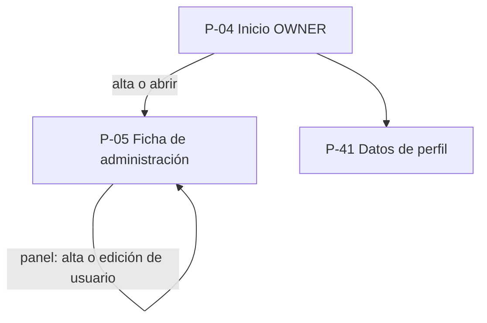
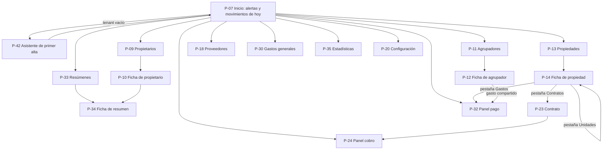
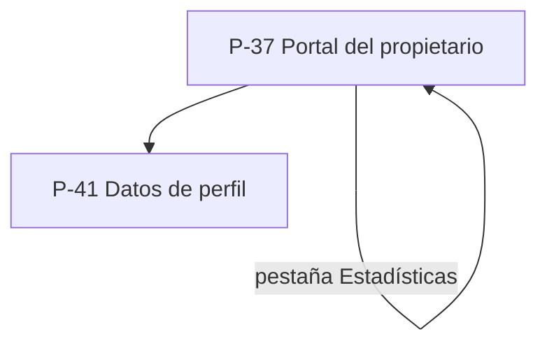
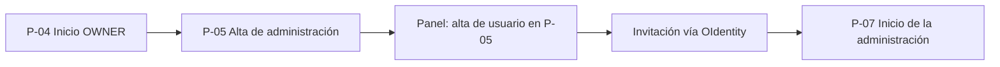
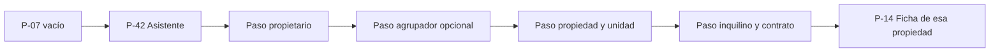
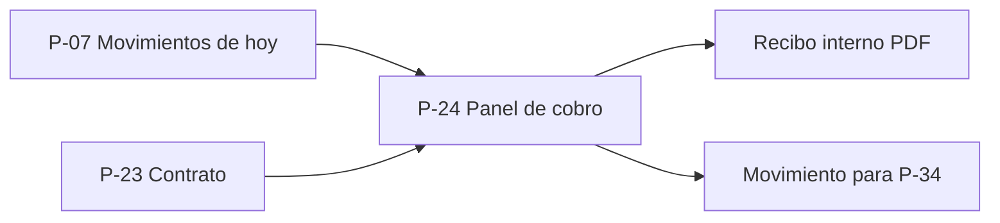
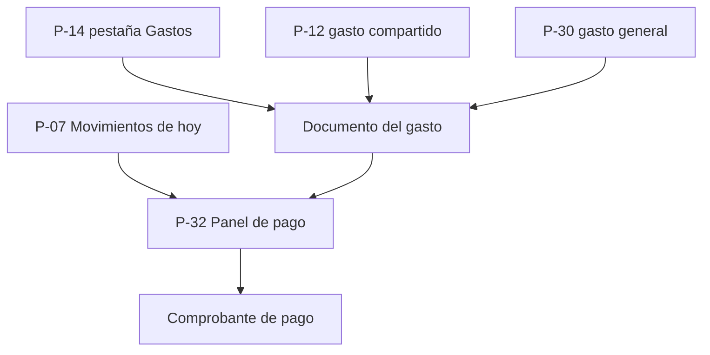
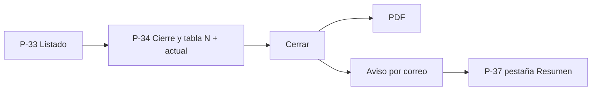
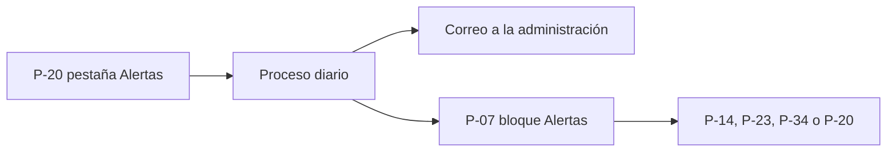
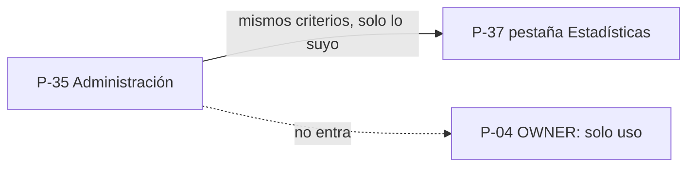

# Inventario de pantallas — MVP

> Versión 0.3 · Fecha: 09/11/2026
> Fuente de verdad: [alcance-sistema-propiedades.md](./alcance-sistema-propiedades.md) v0.8.
> Este documento inventaría **pantallas y navegación** del MVP. No define modelo de datos ni implementación.
> Cambios en 0.2: login, roles y **autorización de entradas de menú** los resuelve **OIdentity** (GrupoL-Informe). Este inventario no incluye pantallas de ingreso ni un menú propio.
> Cambios en 0.3: **pocas pantallas-hub** (lo necesario se ve en la ficha, no navegando listados globales); **ayuda contextual** al estilo **sensoresorigin**; listados tabla compacta / tarjetas; ficha de propiedad con pestañas; cobros y pagos desde el origen y desde “movimientos de hoy”; interruptor global de moneda; asistente solo en la primera alta.

El MVP es la **fase 1** del alcance (sección 11). Es un sistema de **registro y control**: ninguna pantalla ejecuta transferencias, cobros ni pagos.

Convenciones:

- **P-nn** identifica una superficie de UI. Los números de 0.2 que se absorbieron quedan anotados entre paréntesis.
- **Menú**: pocas entradas; las autoriza **OIdentity**. El resto son fichas, pestañas o paneles que se abren desde un hub.
- **Usuario de administración**: usuarios del tenant. En datos ven las mismas propiedades; qué ítems de menú ven lo decide OIdentity.
- Fechas en `dd/mm/aaaa`. Importes con formato del **país de la propiedad**, según el interruptor global local/USD (sección 2.3).

---

## 1. Mapa de navegación por perfil

El **menú** lo arma **OIdentity**. Los diagramas son destinos de negocio, no un catálogo de menú.

### 1.1 Acceso (OIdentity, fuera de este inventario)

Login, logout, contraseña, recuperación, 2FA, roles y autorización de entradas de menú son de **OIdentity**. **P-01, P-02 y P-03 no existen.** Tras autenticarse, el usuario cae en P-04, P-07 o P-37.

### 1.2 OWNER

Tres superficies. Los usuarios se dan de alta **dentro** de la ficha de administración, sin otra pantalla.

### 1.3 Usuario de administración

Pocas entradas de menú. La ficha de propiedad es el hub operativo (unidades, contratos y gastos en pestañas). Cobros y pagos se abren como panel desde el origen o desde P-07.

### 1.4 Propietario (solo lectura)

Una sola pantalla con pestañas. El menú del portal lo autoriza OIdentity.

---

## 2. Patrones transversales

### 2.1 Pocas pantallas

Lo que se usa junto se ve junto. No hay listados globales de unidades, contratos, expensas ni impuestos: viven en la **ficha de la propiedad** (P-14). Alertas, vencimientos y “qué cargar hoy” viven en **P-07**. La primera carga del tenant es un **asistente** (P-42); después, ABMs separados (P-09, P-11, P-13, P-23).

### 2.2 Listados: tabla compacta / tarjetas

En escritorio, tabla compacta (muchas filas, una mirada). En celular, tarjetas. Mismos datos y acciones. Aplica a P-04, P-09, P-11, P-13, P-18, P-30 y P-33, y a las listas dentro de fichas.

### 2.3 Interruptor global de moneda

En el chrome de administración y del portal (no en el OWNER): **local / USD**. Vale para todas las pantallas con importes de esa sesión. Usa los montos **ya guardados**; no reconvierte. Si hay ARS y UYU y la vista es local, los totales van **por `IDMoneda`**, sin sumar las dos. No hay columnas lado a lado.

### 2.4 Ayuda contextual (estilo sensoresorigin)

No hay manual ni pantalla de Ayuda. La ayuda está **en** la pantalla, como en **sensoresorigin**:

| Recurso | Dónde | Qué dice |
|---|---|---|
| Texto de propósito | 1 o 2 líneas al entrar | Para qué es esta pantalla y qué **no** hace (si aplica). |
| `?` por campo | Al lado del label de cada control que no se entiende solo | Tooltip de 1–2 oraciones; ejemplo si hace falta. Escritorio: hover o clic. Celular: tap. |
| Texto corto bajo el campo | Solo si hay regla (default, prioridad, bloqueo) | Una línea. No duplica el tooltip. |
| Estado vacío | El vacío **es** la ayuda | Qué hacer ahora, con el CTA. |
| Error | Junto al campo o arriba del guardar | Cómo corregirlo, sin códigos. |

El `?` no va en nombre, fecha ni importe obvios. Sí va en comisión, agrupador, moneda pactada, responsables, prorrateo, cuentas de fondos, “no mueve dinero”, resultado negativo, etc. Cada pantalla de la sección 3 lista sus `?` puntuales.

### 2.5 Adjuntos

Patrón incrustado en cobro, gasto y pago (y se consulta en P-14, P-34 y P-37).

- **Tipos**: documento del gasto (boleta, factura, ticket, liquidación) y comprobante de pago (recibo, constancia de transferencia, ticket de pago).
- Hasta 10 archivos por registro; 10 MB; JPG, PNG, WEBP, HEIC, PDF. Al subir se elige el tipo.
- Si es obligatorio, no se confirma sin el archivo (prioridad propiedad > administración).
- Pago con comprobante = “pagado con comprobante”; sin archivo = “pagado sin comprobante”.
- Vista previa y descarga. No se borra: se anula con motivo.
- **RF / RN**: RF-56, RF-70 a RF-74, RN-19, RN-25, RN-26.

### 2.6 Cobros y pagos: origen y bandeja del día

P-24 y P-32 son **paneles**, no ítems de menú. Se abren:

1. desde el origen (contrato, boleta, expensa, trabajo, gasto); y
2. desde **Movimientos de hoy** en P-07 (elegir tipo → buscar origen → mismo panel).

Texto visible en ambos: **no mueve dinero**.

---

## 3. Pantallas del MVP

### Acceso

P-01, P-02 y P-03 **no existen**: login, logout, contraseña, recuperación, 2FA, roles y menú los resuelve **OIdentity** (RF-03, RF-43, DT-36).

---

### OWNER — M1 y M13

#### 1. P-04 Inicio OWNER

- **Propósito**: listar administraciones con métricas mínimas de uso, sin importes ni datos de negocio.
- **Quién entra**: solo OWNER.
- **Campos / acciones**: nombre, estado, países con propiedades, cantidades de usuarios, propiedades, unidades y propietarios con usuario, último acceso. Alta, abrir P-05, suspender, baja. Búsqueda. Listado: tabla compacta / tarjetas.
- **Vacío / error**: CTA “Dar de alta la primera”. Sin columnas de dinero.
- **Ayuda contextual**: propósito: “Solo ves uso de la plataforma, no lo que cobra cada administración”. `?` en **países**: “Países de las propiedades de esa administración, no un país único del tenant”. `?` en **último acceso**: “Último ingreso de cualquier usuario de esa administración”.
- **RF / RN**: RF-01, RF-67, RF-68, RN-23.

#### 2. P-05 Ficha de administración

- **Propósito**: alta, edición, suspensión y baja del tenant, y de **sus usuarios en la misma ficha** (absorbe P-06: el alta de usuario es un panel, no otra pantalla).
- **Quién entra**: solo OWNER.
- **Campos / acciones**: razón social, CUIT o RUT, estado. Lista de usuarios (nombre, correo, estado, último acceso): alta, editar, suspender, baja, reenviar invitación. El alta pide nombre y correo, vincula OIdentity y dispara la invitación. Rol y menú los asigna OIdentity; acá no hay selector de permisos. Métricas de P-04. Sin configuración operativa (eso es P-20).
- **Vacío / error**: validación fiscal/correo; usuarios vacíos, CTA invitar. Correo ya usado; invitación no entregada, reenviar.
- **Ayuda contextual**: propósito: “El tenant puede operar Argentina y Uruguay; no le pidas un solo país”. `?` en **CUIT/RUT**: “Identificación fiscal de la administración, no de sus propietarios”. `?` en **invitar usuario**: “Le llega el alta por OIdentity; el rol y el menú se asignan allá, no acá”.
- **RF / RN**: RF-01, RF-02, RF-43, RF-49, RF-67, RN-16, RN-23, DT-36.

---

### Administración — inicio

#### 3. P-07 Inicio de la administración

- **Propósito**: el tablero del día. Acá se ve qué hay que cargar, cobrar, pagar o cerrar, **sin ir a otra pantalla a descubrirlo**. Absorbe P-08 (alertas) y el tablero cruzado de impuestos (ex P-27, resumen).
- **Quién entra**: usuario de administración.
- **Campos / acciones**:
  - Interruptor global local/USD (chrome).
  - **Alertas** del tenant (abierta / vista / resuelta), filtro por tipo; clic abre el origen. Misma bandeja para todos los usuarios del tenant.
  - **Movimientos de hoy**: registrar cobro (P-24) o pago (P-32) eligiendo el origen, o atajos “cobrar alquiler”, “cargar boleta”, “cargar gasto”.
  - Contadores: alquileres impagos, obligaciones vencidas o sin boleta, resúmenes sin cerrar, cotización faltante, pagos sin comprobante.
  - Si el tenant no tiene propiedades, CTA al asistente P-42 (no un checklist de cinco ABMs).
- **Vacío / error**: tenant nuevo → P-42. Cotización faltante: aviso persistente a la pestaña Cotizaciones de P-20; no se confirman transacciones nuevas que necesiten tipo de cambio.
- **Ayuda contextual**: propósito: “Registrás lo que ya cobraste o pagaste por fuera; el sistema no transfiere”. `?` en **movimientos de hoy**: “Atajo del día. También podés registrar el cobro o el pago desde el contrato o la boleta”. `?` en **alertas**: “El mail ya salió; acá seguís el estado. Resolver no paga nada: marca que la causa se atendió”. `?` en tipos (pago sin comprobante, resultado negativo, boleta faltante): una línea cada uno, según la tabla 5.1.
- **RF / RN**: RF-04, RF-23, RF-33 a RF-35, RNF-13, tabla 5.1.

---

### Administración — asistente (solo primera vez)

#### 4. P-42 Asistente de primer alta

- **Propósito**: dejar el tenant operativo en un solo recorrido. **Solo la primera vez** (tenant sin propiedades). Después, ABMs separados.
- **Quién entra**: usuario de administración, desde P-07 vacío. No es ítem de menú permanente.
- **Campos / acciones** (pasos en la misma pantalla):
  1. Propietario + comisión (default % sobre el alquiler).
  2. Agrupador, opcional (o “propiedad independiente”).
  3. Propiedad (país, moneda local, vínculo al agrupador) y unidad (titularidad).
  4. Inquilino y contrato (moneda pactada, valor, actualización, responsables por concepto).
  5. Invitar al portal, opcional.
  Se puede salir y retomar. Al terminar, cae en P-14 de esa propiedad.
- **Vacío / error**: paso incompleto, no avanza. País/moneda distintos al agrupador, bloqueo. Unidad sin titularidad, no cierra el contrato.
- **Ayuda contextual**: propósito: “Una sola pasada; después cada cosa se edita en su ficha”. `?` en **agrupador**: “Predio opcional. Edificio y terreno se comportan igual. No es un consorcio: no liquida entre dueños”. `?` en **país y moneda**: “Son de la propiedad, no de la administración”. `?` en **comisión**: “Por defecto, % solo sobre el alquiler cobrado. Más adelante podés exceptuar una propiedad”. `?` en **extraordinaria**: “Por defecto la paga el propietario; se puede pactar al inquilino”.
- **RF / RN**: RF-05 a RF-08, RF-10, RF-44, RF-55, RF-75, RN-07, RN-16, RN-17, RN-20, RN-28.

---

### Administración — maestros

#### 5. P-09 Listado de propietarios

- **Propósito**: ABM de clientes, después del asistente.
- **Quién entra**: usuario de administración.
- **Campos / acciones**: búsqueda, estado, unidades, si tiene usuario de portal. Alta y abrir P-10. Tabla compacta / tarjetas.
- **Vacío / error**: CTA “Dar de alta el primer propietario” (o P-42 si el tenant está vacío).
- **Ayuda contextual**: propósito: “Acá están tus clientes; la comisión se acuerda por propietario”. `?` en **usuario portal**: “Si tiene usuario, entra de solo lectura a lo suyo”.
- **RF / RN**: RF-07, RN-16.

#### 6. P-10 Ficha de propietario

- **Propósito**: datos, comisión, unidades y usuario del portal, en una ficha.
- **Quién entra**: usuario de administración.
- **Campos / acciones**: datos personales y fiscales. Comisión (% o fijo, moneda si es fija, vigencia, historial). Unidades con % de titularidad. Usuario portal: crear, invitar, suspender, baja. Atajo a P-34.
- **Vacío / error**: sin unidades, aviso de que el resumen va a salir vacío. Correo de portal duplicado en el tenant.
- **Ayuda contextual**: propósito: “Todo lo de este cliente, sin saltar a otra ficha para la comisión”. `?` en **% sobre alquiler**: “Solo sobre el valor de la cuota cobrada, no sobre punitorios ni expensas”. `?` en **monto fijo**: “Una vez por mes, no por unidad”. `?` en **titularidad**: “Si hay condominio, cada copropietario ve la unidad completa y su %”. `?` en **invitar portal**: “Rol y menú del portal los autoriza OIdentity”.
- **RF / RN**: RF-07, RF-42, RF-55, RF-61, RN-07, RN-16.

#### 7. P-11 Listado de agrupadores

- **Propósito**: ABM del predio opcional (un solo tipo en v1).
- **Quién entra**: usuario de administración.
- **Campos / acciones**: nombre, dirección, país, cantidades. Alta y abrir P-12. Tabla compacta / tarjetas.
- **Vacío / error**: “No hay agrupadores: las propiedades pueden ser independientes, o se crea el predio acá o al dar de alta la propiedad”.
- **Ayuda contextual**: propósito: “Agrupás unidades del mismo predio para gastar una vez y repartir”. `?` en **tipo**: “En v1 edificio y terreno se comportan igual; el nombre identifica”.
- **RF / RN**: RF-75, RF-76, RN-28.

#### 8. P-12 Ficha de agrupador

- **Propósito**: datos del predio, unidades que se administran, y **gastos compartidos** (absorbe P-31: el alta del gasto es un panel de esta ficha).
- **Quién entra**: usuario de administración.
- **Campos / acciones**: nombre, dirección, país, moneda (la heredan las propiedades). Contacto de la administración del edificio **ajeno** (dato pasivo). Lista de propiedades/unidades con dueño. Panel de gasto compartido: tipo, proveedor, vencimiento, documento del gasto, **un** propietario, criterio (manual / partes iguales / superficie, con sugerencia recordada), reparto, pago P-32. Texto fijo: varios dueños sí; liquidar entre ellos, no.
- **Vacío / error**: sin unidades, CTA a P-14. Propietario sin unidades en el predio, o sin superficie si eligió ese prorrateo: bloqueo. No hay coeficiente ni “liquidar edificio”.
- **Ayuda contextual**: propósito: “No es un consorcio: el gasto se reparte entre unidades de un mismo dueño”. `?` en **criterio**: “Se recuerda para este predio y este tipo de gasto; lo podés cambiar”. `?` en **un propietario**: “Aunque el edificio tenga varios dueños, no se prorratea entre ellos”.
- **RF / RN**: RF-75 a RF-79, RF-81, RN-27, RN-28.

#### 9. P-13 Listado de propiedades

- **Propósito**: entrar a cada ficha-hub. No lista unidades ni contratos.
- **Quién entra**: usuario de administración.
- **Campos / acciones**: filtros país, moneda, agrupador, propietario. Dirección, tipo, país, moneda, agrupador, cantidad de unidades. Alta y abrir P-14. Tabla compacta / tarjetas.
- **Vacío / error**: CTA de alta o, si el tenant está vacío, P-42. No suma ARS con UYU.
- **Ayuda contextual**: propósito: “Abrí la propiedad: unidades, contratos y gastos están adentro”. `?` en **moneda**: “Moneda local de esa propiedad (ARS o UYU)”.
- **RF / RN**: RF-05, RN-20.

#### 10. P-14 Ficha de propiedad (hub)

- **Propósito**: todo lo de esa propiedad, sin listados globales. Pestañas: **Datos | Unidades | Contratos | Gastos**. Absorbe P-15, P-22, P-26, P-27 (filtro de esta propiedad) y P-29.
- **Quién entra**: usuario de administración.
- **Pestaña Datos**: dirección, tipo, **país**, **moneda local**. Agrupador: ninguno, existente o crear en el momento. Excepción de comisión. Excepción de comprobantes. Punitorios por defecto. Si es independiente: contacto del consorcio ajeno.
- **Pestaña Unidades**: identificación, superficie, partidas, nros. de servicio, titularidad %, conceptos de impuesto/servicio (servicios opcionales). Alta/edición en la pestaña (no hay P-15 de menú).
- **Pestaña Contratos**: vigentes y cerrados de **esta** propiedad. Alta o abrir P-23.
- **Pestaña Gastos**: tablero de la propiedad (sin cargar / pendiente / vencido / pagado con o sin comprobante). Cargar expensa (recibida, no calculada), boleta (panel P-28), trabajo. Pago → P-32. Historial.
- **Vacío / error**: sin unidades, CTA en la pestaña Unidades. Conflicto país/moneda vs. agrupador. Sin “tipo consorcio”. Período duplicado o boleta obligatoria faltante, bloqueo en el panel.
- **Ayuda contextual**: propósito: “Lo de esta propiedad está acá; no hace falta otro menú”. `?` **agrupador**: “A lo sumo uno. País y moneda coinciden con el predio”. `?` **excepción de comisión**: “Pisa la del propietario (prioridad propiedad)”. `?` **punitorios**: “Default de la propiedad; el contrato puede pisarlos”. `?` **expensa**: “La carga el consorcio ajeno; el sistema no la calcula”. `?` **servicios opcionales**: “Si no los controlás, no aparecen ni alertan”. `?` **superficie**: “Hace falta para prorratear gastos del predio por m²”.
- **RF / RN**: RF-05 a RF-07, RF-10, RF-17 a RF-29, RF-56, RF-57, RF-80, RN-01 a RN-05, RN-07, RN-09, RN-18 a RN-20, RN-26.

#### 11. P-18 Proveedores

- **Propósito**: ABM y saldo, listado + ficha en la misma pantalla (absorbe P-19: la ficha es panel o mitad inferior).
- **Quién entra**: usuario de administración.
- **Campos / acciones**: rubro, CUIT o RUT, contacto, saldo. Alta en el listado. Historial de trabajos/gastos. Tabla compacta / tarjetas. Se puede crear un proveedor al vuelo desde un gasto en P-14 o P-12.
- **Vacío / error**: CTA de alta. Sin movimientos, solo datos.
- **Ayuda contextual**: propósito: “Dato de quién te factura; no entra al sistema”. `?` en **saldo**: “Trabajos o gastos con pago pendiente, no una cuenta bancaria”.
- **RF / RN**: RF-09, RF-27.

Los **inquilinos** no tienen menú (ex P-16/P-17): se dan de alta en P-42 o en P-23. Sin portal.

---

### Administración — configuración

#### 12. P-20 Configuración de la administración

- **Propósito**: defaults del tenant, en pestañas, para no un menú de cinco ítems. Absorbe P-21 (cotizaciones) y P-36 (bitácora).
- **Quién entra**: usuario de administración.
- **Pestañas**:
  - **Comprobantes**: obligatoriedad por tipo de movimiento y de adjunto (la propiedad puede exceptuar en P-14).
  - **Alertas**: tipos no obligatorios on/off; anticipación y repetición; individual o resumen diario.
  - **Cotizaciones**: calendario ARS/UYU vs. USD, origen automática/manual; carga manual con usuario y fecha. Aviso si falta el día.
  - **Resumen**: **N** de la tabla mes a mes (propuesta 12). No reescribe meses cerrados.
  - **Cuentas de fondos**: etiquetas de referencia (“Caja efectivo”, “Banco X cta. 123”). Sin saldo, sin CBU, sin banco.
  - **Bitácora**: quién creó, modificó o anuló; anterior/nuevo. Los movimientos no se borran: se anulan en el origen, con motivo.
- **Vacío / error**: sin etiqueta de fondos, el primer cobro/pago permite crearla. Día sin cotización: CTA de carga manual; sin ella no hay transacciones nuevas con tipo de cambio. Bitácora vacía en el filtro.
- **Ayuda contextual**: propósito: “Valores de la administración; la propiedad puede exceptuar comisión, comprobantes y punitorios”. `?` **cuenta de fondos**: “Solo una etiqueta de dónde entró o salió; no hay saldo ni transferencia”. `?` **cotización manual**: “Respaldo si falló el servicio; vale para este tenant”. `?` **N meses**: “Cuántos meses previos ves en la tabla; no cambia los ya cerrados”. `?` **bitácora**: “Consulta. Para anular un cobro, abrilo en su origen”.
- **RF / RN**: RF-32, RF-35, RF-40, RF-41, RF-45, RF-49, RF-56, RF-58, RF-65, RN-19, RN-25, RNF-04, RNF-13.

---

### Administración — contrato, cobro y pago (no son menú)

#### 13. P-23 Ficha de contrato

- **Propósito**: alta y seguimiento. Se abre desde la pestaña Contratos de P-14, desde P-42 o desde una alerta. No es entrada de menú (ex P-22).
- **Quién entra**: usuario de administración.
- **Campos / acciones**: unidad, inquilino (alta en el momento), propietarios de la unidad, fechas, **moneda pactada** (local o USD; no cambia en la vigencia), valor inicial, vencimiento, depósito. Actualización: índice, frecuencia, moneda; el sistema **no** calcula el índice, avisa y se carga el valor. Punitorios del contrato. Responsable por concepto (defaults de la unidad; extraordinaria: propietario). Historial de valores; recálculo de cuotas no cobradas. Cuotas y estado. **Cuenta corriente del inquilino** en un bloque de esta misma ficha (absorbe P-25). Cobro → P-24. Finalizar, rescindir, renovar. Tipo temporario no se ofrece.
- **Vacío / error**: otra vigencia tradicional en la misma unidad, bloqueo. Sin valor vigente, sin cuotas. Cuotas USD pendientes se muestran en USD; el equivalente local es referencia hasta el cobro.
- **Ayuda contextual**: propósito: “El contrato guarda la moneda y quién paga cada cosa”. `?` **moneda pactada**: “Local de la propiedad o USD. No se cambia durante la vigencia”. `?` **actualización**: “Avisamos según la frecuencia; el índice lo cargás vos”. `?` **responsables**: “Se copian de la unidad y se pueden cambiar. Sin contrato, paga el propietario”. `?` **cuenta corriente**: “La ve la administración, no el inquilino (no tiene acceso) ni el propietario (él ve el resumen)”.
- **RF / RN**: RF-08, RF-10 a RF-12, RF-14 a RF-16, RF-44, RF-57, RF-59, RN-01 a RN-04, RN-14, RN-17, RN-18.

#### 14. P-24 Panel de cobro

- **Propósito**: anotar un cobro **ya hecho por fuera**. Panel sobre P-07 o P-23.
- **Quién entra**: usuario de administración.
- **Campos / acciones**: fecha, inquilino, aplicación a cuotas/cargos, medio, cuenta de fondos, importe local, cotización del **día del cobro**, `montoUSD`. Si la cuota está en USD, se propone el equivalente local y se cancela en USD. Comisión según excepción de propiedad o default del propietario, solo sobre el alquiler. Comprobante de cobro. Recibo interno PDF. Vista según interruptor global. **No mueve dinero**.
- **Vacío / error**: sin cotización del día, no confirma. Parcial deja saldo y alerta. Mes cerrado → ajuste al mes siguiente. Adjunto obligatorio según P-20/P-14.
- **Ayuda contextual**: propósito: “Registrás lo cobrado; no se transfiere nada”. `?` **cotización**: “La del día del cobro, no la del cierre de mes”. `?` **parcial**: “El resto sigue en la moneda pactada (USD si el contrato está en USD)”. `?` **comisión**: “Se descuenta en el resumen, no es un giro al propietario”.
- **RF / RN**: RF-13, RF-61, RF-66, RF-71, RN-07, RN-08, RN-11, RN-12, RN-22, RN-25.

#### 15. P-28 Panel de carga de obligación

- **Propósito**: cargar boleta de impuesto o servicio. Panel desde la pestaña Gastos de P-14 o desde P-07.
- **Quién entra**: usuario de administración.
- **Campos / acciones**: concepto, período, importe local, vencimiento, responsable efectivo, documento del gasto. Pago posterior → P-32.
- **Vacío / error**: boleta obligatoria ausente o período duplicado, bloqueo.
- **Ayuda contextual**: propósito: “Cargás la boleta que llegó; no se descarga de ningún organismo”. `?` **responsable**: “El del contrato para ese concepto; sin contrato, el propietario”.
- **RF / RN**: RF-20, RF-21, RF-66, RF-70, RN-03, RN-04, RN-19.

La **expensa** se carga en un panel equivalente desde P-14 Gastos: ordinario y extraordinario, liquidación adjunta, responsable de cada parte (extraordinaria default propietario, editable). RF-17, RF-18, RN-01, RN-02. El sistema no calcula la expensa.

#### 16. P-32 Panel de pago

- **Propósito**: anotar un pago **ya hecho por fuera**. Panel desde P-07, P-12, P-14 o P-30.
- **Quién entra**: usuario de administración.
- **Campos / acciones**: origen, fecha, medio, cuenta de fondos, quién pagó (administración por cuenta del propietario, o directo del inquilino/propietario), parcial o total, comprobante de pago. **No mueve dinero**. No existe “pagar al propietario”.
- **Vacío / error**: comprobante obligatorio ausente, bloqueo. Parcial deja saldo. Mes cerrado → ajuste. Sin comprobante (si es opcional) queda marcado y puede alertar.
- **Ayuda contextual**: propósito: “Evidencia documental de un pago que ya hiciste”. `?` **quién pagó**: “Si lo pagó la administración, se debita al propietario. Si lo pagó el inquilino o el dueño directo, solo se marca pagado”. `?` **con/sin comprobante**: “Con archivo = pagado con comprobante. No verifica el banco ni el organismo”.
- **RF / RN**: RF-19, RF-21, RF-27, RF-45, RF-71 a RF-73, RN-08, RN-12, RN-19, RN-24 a RN-26.

---

### Administración — gastos de la administración y cierre

#### 17. P-30 Gastos generales

- **Propósito**: gastos no atados a una unidad, con imputación opcional. Listado + ficha en la misma pantalla.
- **Quién entra**: usuario de administración.
- **Campos / acciones**: categoría, proveedor, importe, fecha, documento del gasto. Imputación total o parcial a uno o más propietarios (y opcionalmente a una propiedad), por importe o %. Remanente = gasto de la administración. Pago → P-32. Tabla compacta / tarjetas.
- **Vacío / error**: suma imputada > total, bloqueo. Sin imputación, no sale en el portal (RF-54).
- **Ayuda contextual**: propósito: “Gasto del estudio; solo lo imputado aparece en el resumen del cliente”. `?` **imputación**: “La suma no puede pasar el total. El resto queda como gasto de la administración”.
- **RF / RN**: RF-29, RF-30, RF-60, RN-06.

#### 18. P-33 Listado de resúmenes

- **Propósito**: ver, por propietario y mes, si el cierre está abierto o cerrado.
- **Quién entra**: usuario de administración.
- **Campos / acciones**: filtros propietario, mes, estado. Resultado del mes, arrastrado, final, publicado. Según interruptor global (un importe, no dos columnas). Abrir P-34. Tabla compacta / tarjetas.
- **Vacío / error**: sin movimientos, igual se puede cerrar en cero. Sin columna “girado” ni “saldo a rendir”.
- **Ayuda contextual**: propósito: “Estado de resultados del mes, no una cuenta de lo que le giraste”. `?` **publicado**: “El propietario ya lo ve en el portal y le llegó el mail”.
- **RF / RN**: RF-32, RF-47, RN-21, RN-24.

#### 19. P-34 Ficha de resumen (cierre + tabla mes a mes)

- **Propósito**: detalle del mes, tabla N + actual, cerrar y publicar. El propietario ve lo mismo, de solo lectura, en P-37.
- **Quién entra**: usuario de administración.
- **Campos / acciones**: vista según interruptor global. Detalle: alquileres cobrados, comisión, extraordinarias, impuestos, trabajos, gastos generales imputados, gastos compartidos (por unidad), otros pagos por su cuenta. Resultado del mes, negativo arrastrado (sin interés ni depósito), resultado final. Positivos **no** se arrastran como saldo a girar. Tabla mes a mes. Cerrar (inmutable; corrección = ajuste al mes siguiente). PDF. Publicar y avisar por correo.
- **Vacío / error**: faltantes (boletas, sin comprobante): aviso, no bloquea por defecto. Mes cerrado: no se edita. Resultado negativo: alerta informativa.
- **Ayuda contextual**: propósito: “Cobrado − comisión − pagado por su cuenta. No registra el giro al propietario”. `?` **negativo arrastrado**: “Pasa al mes siguiente sin interés y sin pedir depósito”. `?` **USD**: “Suma los `montoUSD` ya guardados; no reconvierte el mes”. `?` **cerrar**: “Después no se toca; lo que falte va al mes siguiente como ajuste”.
- **RF / RN**: RF-31, RF-32, RF-46 a RF-48, RF-61, RF-82, RN-13, RN-21, RN-24.

#### 20. P-35 Estadísticas

- **Propósito**: ingresos, gastos, comisión y margen, por mes y acumulado, por propiedad, agrupador o administración.
- **Quién entra**: usuario de administración. El OWNER no entra.
- **Campos / acciones**: alcance y rango. Vista según interruptor global. Series: ingresos, gastos a cargo del propietario (incluye compartidos imputados), comisión, margen del propietario. A nivel administración: comisión total, gastos generales no imputados, margen (comisión − no imputados). Importes ya guardados. Sin Excel/CSV en este MVP; el PDF del resumen está en P-34.
- **Vacío / error**: sin movimientos. Mix ARS+UYU en vista local: totales por moneda, comparable en USD. Sin morosidad/vacancia/rentabilidad (fase 2).
- **Ayuda contextual**: propósito: “Números ya registrados; no se vuelven a convertir al consultar”. `?` **margen administración**: “Comisión menos gastos generales no imputados”. `?` **alcance agrupador**: “Suma las unidades que administrás en ese predio, no el edificio entero”.
- **RF / RN**: RF-36, RF-37, RF-38, RN-20.

---

### Portal del propietario — M12

#### 21. P-37 Portal del propietario

- **Propósito**: todo lo suyo en **una** pantalla con pestañas (absorbe P-38, P-39 y P-40). Solo lectura.
- **Quién entra**: propietario, unidades con titularidad. Menú que OIdentity autorizó.
- **Pestaña Resumen y tabla**: foto del mes (cobrado, ganado, pagado), vencimientos e impagos **a su cargo**, cierre publicado, PDF, tabla N + actual, movimientos del período. Interruptor global local/USD.
- **Pestaña Unidades y comprobantes**: impuestos, expensas, trabajos, gastos imputados y compartidos (solo **su** parte), adjuntos.
- **Pestaña Estadísticas**: mismas métricas que P-35, recortadas a lo suyo.
- **Vacío / error**: sin resumen publicado, “la administración todavía no cerró el mes”. Sin escrituras, pedidos ni mensajes. No ve giros, ni gastos no imputados, ni otros propietarios. En condominio: unidad completa y su %.
- **Ayuda contextual**: propósito: “Consulta de tus propiedades; no se carga ni se aprueba nada acá”. `?` **resultado**: “Cobrado menos comisión y menos lo pagado por tu cuenta. No es lo que la administración ya te giró”. `?` **USD**: “Importes guardados en cada movimiento, no una conversión de hoy”. `?` **gasto compartido**: “Tu parte en ese predio, no el gasto de otros dueños”.
- **RF / RN**: RF-50 a RF-54, RF-64, RF-74, RF-82, RN-15, RN-24, RN-27.

---

### Común

#### 22. P-41 Datos de perfil

- **Propósito**: nombre y correo de este sistema. Contraseña, 2FA y logout son de **OIdentity**.
- **Quién entra**: a quien OIdentity le autorizó la entrada.
- **Campos / acciones**: nombre, correo. Enlace a OIdentity. El propietario no cambia unidades. El usuario de administración no crea colegas.
- **Vacío / error**: sin pantallas de contraseña acá.
- **Ayuda contextual**: propósito: “Datos de este sistema. La cuenta (clave, 2FA, salir) está en OIdentity”. `?` no hace falta en correo.
- **RF / RN**: RF-03, RF-43, DT-36.

---

## 4. Flujos clave

Ningún paso mueve dinero. El interruptor de moneda acompaña todo el flujo de administración y del portal.

### 4.1 Alta de administración y usuarios (OWNER)

Sin autoregistro (RN-16). Rol y menú los asigna OIdentity. El OWNER, de vuelta en P-04/P-05, solo ve uso (RF-67, RN-23).

### 4.2 Alta de propietario, agrupador, propiedad/unidad y contrato

**Primera vez** (tenant vacío): un solo asistente.

**Después**: ABMs separados (P-09, P-11, P-13) y contrato desde la pestaña de P-14. El agrupador se puede crear al vuelo en P-14. Comisión en el propietario; excepción en la propiedad. Extraordinaria default: propietario.

### 4.3 Registro de cobro

Si el contrato está en USD, P-24 usa la cotización del **día del cobro**. Comisión al resumen, no como giro. Parcial = saldo + alerta.

### 4.4 Registro de gasto/pago con adjuntos

Un gasto puede tener **los dos** archivos. En P-12, antes del pago: un propietario y criterio de prorrateo (sugerido).

### 4.5 Resumen mensual + tabla mes a mes

Criterio caja. Mes cerrado inmutable. No se registra el giro. Publicar dispara RF-62.

### 4.6 Alertas

Siempre correo + bandeja en el inicio. El propietario no ve esta bandeja; le llega el mail del resumen.

### 4.7 Estadísticas

Interruptor global. Comparable en USD si hay dos locales. Sin reconversión al consultar.

---

## 5. Qué queda fuera de pantallas (MVP)

| Tema | Qué no se diseña |
|---|---|
| **Consorcio** | Liquidación del edificio, coeficiente, expensas calculadas, informe a todos los copropietarios, rol consorcio. El agrupador (P-11/P-12) puede tener varios dueños y **no** liquida entre ellos. La expensa de P-14 es la que emite un consorcio **ajeno**. |
| **Giros al propietario** | Rendición, transferencia, saldo a girar, saldo de caja. P-34 y P-37 informan resultado, no “cuánto le mandamos”. |
| **Acceso de inquilinos** | Portal, recibos self-service, pagos en línea. El inquilino es dato de P-23/P-42. Tampoco hay acceso de proveedores. |
| **Cobro de la plataforma** | Planes, facturación a las administraciones, pasarela. El OWNER no ve importes (P-04/P-05). |
| **Login / roles / menú** | OIdentity. P-01, P-02 y P-03 no existen. |

Tampoco: autoregistro; escritura del propietario; alquileres temporarios; Excel/CSV de estadísticas; tablero de morosidad/vacancia/rentabilidad; OCR; WhatsApp/SMS; app nativa; facturación electrónica; conciliación bancaria; pantalla de Ayuda / manual.

---

## 6. Decisiones de UI (cerradas en 0.3)

Propuestas avaladas en espíritu por el usuario. No quedan preguntas abiertas de presentación.

1. **Listados**: tabla compacta en escritorio, tarjetas en celular.
2. **Ficha de propiedad**: pestañas Unidades, Contratos y Gastos. Sin listados globales de esas entidades.
3. **Cobros y pagos**: desde el origen **y** desde “Movimientos de hoy” en P-07.
4. **Moneda**: interruptor global local/USD. No columnas lado a lado.
5. **Primer alta**: asistente único (P-42). Después, ABMs separados.
6. **Densidad de información**: pocas pantallas-hub; no obligar a navegar para encontrar lo necesario.
7. **Ayuda**: contextual en cada pantalla, estilo **sensoresorigin** (`?` por campo, textos cortos). Sin pantalla de Ayuda.

---

## 7. Correspondencia módulo → pantallas

| Módulo | Dónde vive |
|---|---|
| M1 / OIdentity | P-04, P-05 (usuarios en la ficha), P-10 (usuario portal), P-41. Login/roles/menú: OIdentity. |
| M13 Panel OWNER | P-04, P-05 |
| M2 Maestros | P-09, P-10, P-11, P-12, P-13, P-14, P-18, P-20, P-42 |
| M3 Contratos y cobros | P-14 pestaña Contratos, P-23, P-24, P-07 |
| M4 Expensas | P-14 pestaña Gastos, P-32 |
| M5 Impuestos y servicios | P-14 Unidades y Gastos, P-28, P-07, P-32 |
| M6 Trabajos | P-14 pestaña Gastos, P-32 |
| M7 Gastos generales | P-30, P-32 |
| M15 Agrupadores | P-11, P-12 (gasto compartido), P-32 |
| M14 Adjuntos | patrón 2.5 |
| M8 Resumen | P-33, P-34, P-37 |
| M9 Alertas | P-07, P-20 pestaña Alertas |
| M10 Estadísticas | P-35, P-37 pestaña Estadísticas |
| M11 Auditoría | P-20 pestaña Bitácora |
| M12 Portal | P-37 |

Números de 0.2 absorbidos: P-01/P-02/P-03 (OIdentity); P-06 → panel de P-05; P-08 → P-07; P-15/P-22/P-26/P-27/P-29 → P-14; P-16/P-17 → P-23 y P-42; P-19 → P-18; P-21 y P-36 → P-20; P-25 → bloque de P-23; P-31 → P-12; P-38/P-39/P-40 → pestañas de P-37.
